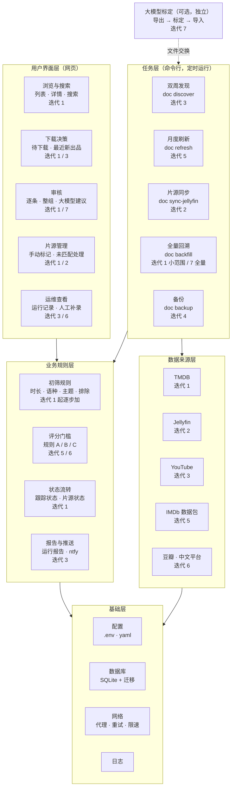
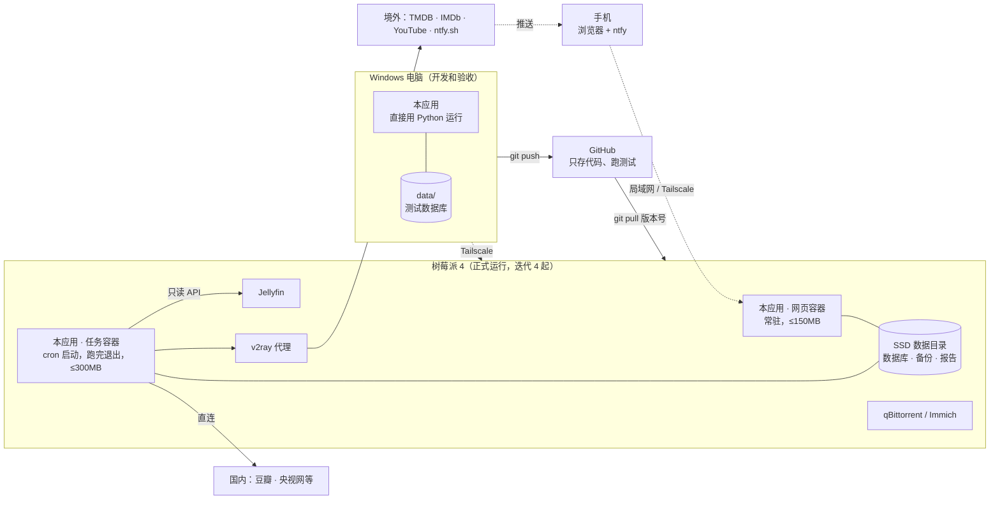

# 技术架构（草稿）

> 阶段 1 的交付物之一。依据 `requirements.md`（部署环境、内存预算、大模型模块）和 `tracking.md`（双周 / 月度任务）。
> 已经能定的直接写成结论；第 10 节记录已确认的决定和剩下的问题。

---

## 1. 技术选型

| 项目 | 选择 | 理由 |
|---|---|---|
| 语言 | **Python 3.12** | Windows 和树莓派（ARM64）都能直接装；抓网页、处理 TSV、调 API 的库最齐全；`requirements.md` 已按“装好 Python 即可”设计 |
| 依赖管理 | **uv**（`pyproject.toml` + `uv.lock`） | Windows 上一条命令装好；锁文件保证电脑和树莓派装的版本完全一致 |
| 数据库 | **SQLite**（WAL 模式） | 单文件，迁移时直接拷；内存占用极小；WAL 模式下网页读、定时任务写可以同时进行 |
| 数据库访问 | **SQLAlchemy 2.0** + **Alembic** | Alembic 管表结构变更，以后改数据模型不用手动改库 |
| 网页 | **FastAPI** + **Jinja2 模板** + **htmx** | 服务端渲染，不需要 Node / 前端构建；htmx 让“一键切换片源状态”“批量审核”这类操作不刷新页面；常驻内存约 60–100MB，在 150MB 预算内 |
| 网页服务器 | Uvicorn，单进程 | 个人使用，单进程足够，也最省内存 |
| HTTP 请求 | **httpx** | 支持按请求指定代理，方便“境外走代理、国内直连”（第 5 节） |
| 网页解析 | BeautifulSoup + lxml | 豆瓣、央视网等栏目页；lxml 有 ARM64 预编译包 |
| 配置 | YAML（品牌、频道、规则） + `.env`（密钥、路径、代理） | YAML 方便手改和看 diff；密钥不进仓库 |
| 命令行 | **Typer** | 所有定时任务和工具都是命令，测试时手动跑，上线后 cron 调用同一条命令 |
| 测试 / 代码检查 | pytest + ruff | 来源接口的响应存成样例文件做离线测试，不在测试里真的调 API |
| 部署 | Docker（`python:3.12-slim`，ARM64）+ docker compose | 镜像在树莓派上直接构建，不做跨架构构建 |

**没有选的方案**

- Node.js / Go：Go 内存更省，但抓网页和数据处理要多写不少代码；Node 需要额外的前端构建链。对这个规模，Python 的内存已经够用。
- 前后端分离（React / Vue）：多一套构建和部署，个人使用收益不大。
- PostgreSQL / MySQL：树莓派上常驻几百 MB，没必要。

---

## 2. 系统结构

本节有三张图，从不同角度看同一个系统：
- **2.1 功能架构图**：系统由哪些功能组成，每块功能在哪个迭代做。
- **2.2 运行结构图**：数据从哪里来、经过什么处理、到哪里去。
- **2.3 部署结构图**：程序装在哪台机器上、怎么连起来。

### 2.1 功能架构图



- 上层调用下层，下层不知道上层的存在。比如“数据来源层”只负责把数据拿回来，不知道网页长什么样；以后换一个来源或加一个来源，不影响网页。
- 大模型标定是虚线：只通过文件和主系统交换数据，不用它主系统照样完整可用。

### 2.2 运行结构图

```
                         ┌──────────────────────────────────────────┐
  境外（走 v2ray 代理）   │                采集（sources）            │
  TMDB API ─────────────►│  tmdb  imdb  youtube                     │
  IMDb 数据包 ──────────►│                                          │
  YouTube Data API ─────►│                                          │
                         │                                          │
  国内（直连）            │                                          │
  豆瓣 ─────────────────►│  douban  cn_sites                        │
  央视网 / 腾讯 / 优酷 ──►│                                          │
                         └───────────────┬──────────────────────────┘
                                         │ 原始条目
                                         ▼
                         ┌──────────────────────────────────────────┐
                         │             流程（pipeline）               │
                         │  初筛：时长 / 语种 / 主题规则 / 排除规则     │
                         │  状态流转：待审核 / 观察中 / 待播 …         │
                         │  评分刷新（每月）                          │
                         └───────┬───────────────────────┬──────────┘
                                 │                       │ 导出 JSONL
                                 ▼                       ▼
  Jellyfin API ──► 片源同步 ──► ┌────────────┐     ┌──────────────────┐
     （只读）                    │  SQLite    │◄────│ 大模型标定（可选）  │
                                │  数据库     │ 导入 │ 网页对话 / Claude  │
                                └─────┬──────┘     │ Code / API 均可    │
                                      │            └──────────────────┘
                                      ▼
                         ┌──────────────────────────────────────────┐
                         │              网页（web）                   │
                         │  列表 / 详情 / 待下载 / 最近新出品 / 审核     │
                         │  片源状态标记                              │
                         └──────────────────────────────────────────┘
                                      ▲
                          浏览器（局域网 / Tailscale）
```

- **网页**是常驻服务；**采集、刷新、同步**都是命令行任务，跑完就退出，不常驻内存。
- 网页和任务共用同一个 SQLite 文件、同一套代码，只是入口不同。
- 大模型模块和主服务之间只通过文件交换数据，主服务不依赖它。

### 2.3 部署结构图



- 电脑和树莓派运行**同一份代码**，区别只在 `.env` 配置。
- 代码从电脑推到 GitHub，树莓派从 GitHub 拉取打了版本号的代码（`process.md` 第 3 节）。
- 网页只在家庭局域网和 Tailscale 内可以访问，不暴露到公网。

---

## 3. 模块划分

| 模块 | 负责 | 不负责 |
|---|---|---|
| `core` | 配置加载、数据库连接、数据模型、日志、HTTP 客户端（含代理选择） | 任何来源的具体逻辑 |
| `sources` | 每个来源一个子模块：调用接口 / 抓网页 → 转成统一的“原始条目”结构。只管“拿到数据”，不判断是否收录 | 状态、规则 |
| `pipeline` | 初筛规则（时长、语种、主题、排除类型）、纪录长片评分门槛、跟踪状态流转、评分刷新调度、每次运行的检查时间记录 | 抓取细节 |
| `sync` | Jellyfin 片源同步：按 TMDB / IMDb 编号匹配，匹配不上按标题，结果写片源状态 | 修改 Jellyfin |
| `llm` | 导出待标定条目、导入标定结果（带格式校验）、提供提示词模板；可选的 API 调用脚本 | 主服务的任何必需流程 |
| `web` | 页面、筛选、搜索、审核操作、片源状态切换、运行报告展示 | 调用外部接口（网页只读写数据库） |
| `cli` | 把上面各模块包装成命令（第 6 节） | |

**审核放在网页里**（`requirements.md` 3.5），不单独做工具。审核页在迭代 1 就做（`plan.md`）。

### 3.1 各来源的要点

| 来源 | 要点 |
|---|---|
| TMDB | 按配置表里的播出方 / 公司 ID 调 `discover`；请求间隔控制在官方限速内；结果按 TMDB ID 去重 |
| IMDb 数据包 | 只下载 `title.basics`、`title.ratings`、`title.episode` 三个文件；**逐行流式读 gzip**，只保留类型含 `Documentary` 的行写入数据库，峰值内存远低于 300MB；按 `Last-Modified` 判断是否需要重新下载；下载文件放数据目录（不放 SD 卡） |
| YouTube | `playlistItems.list` 翻页到上次检查时间，`videos.list` 每 50 条一批取时长；每次运行记录配额用量 |
| 豆瓣 | 低频（每次请求间隔 5–10 秒，加随机抖动），直连；失败或被拦截时不重试轰炸，标记为“需要人工补录”，在审核页提示 |
| 中文平台栏目页 | 每个站点一个解析器；页面结构变了解析出 0 条时视为失败（而不是“没有新内容”），在报告里提示 |

---

## 4. 目录结构

```
Documentary/
├── pyproject.toml / uv.lock
├── .gitattributes            # 统一 LF
├── .env.example              # 配置项样例（不含真实密钥）
├── Dockerfile
├── docker-compose.yml
├── alembic/                  # 数据库表结构迁移
├── config/
│   ├── brands.yaml           # 品牌 → TMDB 播出方/公司 ID、起始年份、默认主题
│   ├── channels.yaml         # YouTube 频道 ID、类型、时长门槛、默认主题
│   └── rules.yaml            # 主题关键词、排除关键词、来源分类映射、评分门槛
├── src/documentary/
│   ├── core/                 # config.py  db.py  models.py  http.py  logging.py
│   ├── sources/              # tmdb.py  imdb.py  youtube.py  douban.py  cn_sites/
│   ├── pipeline/             # prescreen.py  themes.py  thresholds.py  states.py  refresh.py
│   ├── sync/                 # jellyfin.py
│   ├── llm/                  # export.py  import_.py  prompt.md  run_api.py（可选）
│   ├── web/                  # app.py  routes/  templates/  static/
│   └── cli.py
├── tests/                    # 测试和来源响应样例
├── docs/
└── reports/                  # 回溯报告、试运行报告（需要提交到仓库的那些）
```

**数据目录**（不在仓库里，位置由 `DATA_DIR` 配置）：

```
<DATA_DIR>/
├── documentary.db            # 主数据库
├── backups/                  # 每日备份
├── imdb/                     # 下载的 IMDb 数据包
├── llm/                      # 大模型导出 / 结果文件
├── runs/                     # 每次任务的运行报告和日志
└── manual/                   # 豆瓣等人工补录的导入文件
```

Windows 上默认放在项目旁边的 `data/`（已加进 `.gitignore`）。树莓派整个系统都在 SSD 上，没有 SD 卡寿命问题，数据目录默认放 `/opt/documentary/data`，通过 docker compose 挂载进容器；如果你的其他 Docker 服务有统一的数据目录习惯，跟着那个走。

---

## 5. 网络与代理

- `.env` 里配置一个代理地址 `PROXY_URL`（树莓派上是 v2ray 容器的本地端口，Windows 上换成电脑上的代理）。
- 每个来源在代码里声明自己走哪条路：`tmdb` / `imdb` / `youtube` / `jellyfin（外网时）` 走代理，`douban` / `cn_sites` 直连。由 `core/http.py` 统一创建客户端，来源模块不自己处理代理。
- Jellyfin 在同一台树莓派上，走 Docker 内网或局域网地址，不经过代理。
- 所有请求统一设置超时、有限次数重试（指数退避）、User-Agent。

---

## 6. 任务与调度

所有任务都是 `cli` 命令（命令名为示意，实现时可调整）：

| 命令 | 内容 | 定时（树莓派上） | 手动运行 |
|---|---|---|---|
| `doc backfill` | 全量回溯（按来源、按年份分段，可断点续跑） | 不定时 | 只跑一次，手动 |
| `doc discover` | 双周发现：TMDB、YouTube、中文平台、待播检查 | 每两周，深夜 | 命令行 / 网页按钮 |
| `doc refresh` | 月度：更新 IMDb 数据包、刷新 12 个月内作品评分、处理 `观察中` | 每月，深夜 | 命令行 / 网页按钮 |
| `doc sync-jellyfin` | 片源状态同步 | 每天，深夜 | 命令行 / 网页按钮 |
| `doc llm-export` / `doc llm-import` | 大模型标定的导出 / 导入 | 不定时 | 命令行 |
| `doc backup` | SQLite 在线备份，保留最近 N 份 | 每天 | 命令行 |

**所有任务都能手动运行**（场景 S0）。采集类任务的通用参数：

| 参数 | 作用 |
|---|---|
| `--source tmdb` | 只跑某个来源 |
| `--brand bbc-earth` / `--channel veritasium` | 只跑某个品牌或频道 |
| `--dry-run` | 照常抓取和初筛，只列出会改什么，不写数据库 |
| `--force` | 忽略“距上次成功满 14 天”的判断；手动运行时默认就是这样，定时任务不加 |

- 树莓派上手动运行：部署目录里放一个包装脚本 `./doc <命令>`，等同于 `docker compose run --rm app doc <命令>`，SSH 进去敲一条命令即可（写进迭代 4 的 `operations.md`）。

- **调度用树莓派本机 cron**，执行 `docker compose run --rm app doc <命令>`：任务在临时容器里运行，跑完即退出，崩溃不影响网页服务。不在容器里再装调度器。
- 双周任务的“每两周”用 cron 每周触发 + 程序内判断距上次成功是否满 14 天，避免 cron 表达不了双周的问题；也方便某次失败后下周自动补跑。
- **任务锁**：同一时间只允许一个任务写数据库（数据目录里放锁文件），防止 cron 重叠。
- **检查时间按来源分别记录**：某个来源失败，下次从它上次成功的时间继续（`tracking.md` 第 3 节）。
- 测试阶段在 Windows 上手动执行同样的命令。

### 6.1 运行报告

每次任务结束（无论成功还是失败）都生成一份报告，写到 `<DATA_DIR>/runs/<日期>-<任务>.md`，同时在数据库记一条运行记录，网页“运行记录”页可以看。报告内容：

| 部分 | 内容 |
|---|---|
| 概要 | 任务名、开始/结束时间、耗时、整体结果（成功 / 部分失败 / 失败） |
| 新增 | 按来源分组列出新发现的条目（标题、品牌/频道、类型、初筛建议），带链接到审核页 |
| 状态变化 | `观察中` → `待审核`、`待播` → `待审核`、满 12 个月转 `已排除`、片源状态变为 `已入库` 等 |
| 评分变化 | 月度刷新时评分或评分人数有明显变化的作品 |
| 失败 | 每个失败的来源：错误类型、错误信息、已连续失败几次、下次从哪个时间点继续 |
| 需要人工处理 | 豆瓣被拦截需补录、栏目页解析为 0 条、Jellyfin 匹配不上的作品 |
| 统计 | 各来源请求数、YouTube 配额用量、待审核总数 |

### 6.2 ntfy 推送

每次任务结束后，往 ntfy 发一条**简要**消息，详细内容看报告：

```
标题：双周发现完成（部分失败）
内容：新增待审核 23 条（TMDB 9、YouTube 14）
      观察中转待审核 2 条
      失败：豆瓣（连续 2 次）
点击：打开网页上的这次运行报告
```

- 优先级：全部成功用普通优先级；有来源失败用高优先级；同一来源**连续失败 3 次**单独再发一条告警。
- 点击链接指向网页上的报告页（局域网地址或 Tailscale 地址，配置项）。
- ntfy 服务地址和 topic 写在 `.env`（`NTFY_URL`、`NTFY_TOPIC`）。默认用公共的 ntfy.sh：topic 名用一串随机字符（公共服务上 topic 名就是“密码”），推送里只放片名和数量，不放密钥和内网细节。ntfy.sh 在境外，推送请求走代理。
- 也可以以后在树莓派上自建 ntfy（很轻量），手机通过 Tailscale 连接；改两个配置项即可，代码不变。
- 推送失败不影响任务本身，只在报告里记一笔。

### 6.3 网页“立即更新”按钮

- 网页**不在自己的进程里跑任务**：IMDb 刷新这类任务要用到 300MB 内存，在网页进程里跑会超过网页容器的内存上限，任务出错也可能拖垮网页。
- 点按钮时，网页只在 `<DATA_DIR>/requests/` 写一个**任务请求**文件（任务名、来源、参数），同时在数据库记一条“排队中”的运行记录。
- 谁来执行请求，由 `.env` 里的 `TASK_LAUNCHER` 决定，代码相同：
  - `subprocess`（Windows 测试用）：网页直接另起一个独立的子进程运行命令。
  - `queue`（树莓派用）：本机 cron 每分钟运行一个很小的 shell 脚本，发现请求文件才执行 `docker compose run --rm app doc <命令>`，没有请求就立即退出，几乎不占资源。点按钮后最多一分钟内开始运行。
- 和定时任务**共用任务锁**：同一时间只跑一个任务。有任务在跑时按钮变灰，显示“正在运行”和进度（当前在抓哪个来源）。
- 跑完和定时任务一样：生成报告、发 ntfy 推送，页面上显示报告链接。

---

## 7. 密钥与配置管理

- 密钥（TMDB、YouTube、Jellyfin API key）和环境相关的配置（`DATA_DIR`、`PROXY_URL`、网页端口）全部放在 `.env`，**不进仓库**；仓库里只有 `.env.example`。
- 加载方式：`pydantic-settings` 读环境变量和 `.env`，启动时校验，缺项直接报错并指出是哪一项。
- 只有用到某个来源时才要求它的密钥（例如没配 YouTube key 也能跑 TMDB 和网页）。
- 树莓派上：`.env` 放在部署目录，权限 `600`，docker compose 用 `env_file` 读入。
- 日志和运行报告里不打印密钥（HTTP 客户端统一脱敏 URL 里的 `api_key` 参数）。
- 品牌、频道、规则这类**非敏感配置**放 `config/*.yaml`，进仓库，改动可追踪。

---

## 8. 大模型标定模块

按 `requirements.md` 第 5 节的设计，具体接口：

- **导出**：`doc llm-export` 把“前三步没判断出主题”的条目写成 JSONL，每行一条：`id`、标题（中/英）、简介、来源、品牌/频道、时长、来源分类。可以按条数分批，方便分批上传到网页对话。
- **提示词**：`llm/prompt.md` 固定主题标签列表和排除类型（与 `scope.md` 第 6 节一致），要求输出 JSONL：`id`、主题标签、排除建议（是/否 + 理由）、置信度。
- **导入**：`doc llm-import` 校验格式（未知 `id`、不在列表里的主题标签都拒收并列出），写入“建议”字段，**不直接改跟踪状态**，审核时作为建议显示。
- **运行方式**可以随时换：网页对话、Claude Code / Codex 命令行（读导出文件、写结果文件），或者以后用 API 的 `run_api.py`。主服务对此无感知。

---

## 9. 部署与运维

### 9.1 从 Windows 迁移到树莓派

1. 树莓派上 `git clone` 仓库，复制 `.env`（改 `DATA_DIR`、`PROXY_URL`）。
2. 把 Windows 上的 `documentary.db` 拷到树莓派的数据目录（IMDb 数据包可以不拷，重新下载）。
3. `docker compose build && docker compose up -d`，启动网页。
4. 配置 cron（第 6 节）。

代码两边一致，只有 `.env` 不同。

### 9.2 在 Windows 上测试 Jellyfin 同步

**不需要拷贝 Jellyfin 的媒体库文件夹。** 同步只调用 Jellyfin 的 API 读“媒体库里有哪些作品、各自的 TMDB / IMDb 编号、有哪些季和集”，不读视频文件，也不读 Jellyfin 的数据库文件。所以测试方式是：

1. 在 Jellyfin 后台生成一个 API key（只用于读取）。
2. Windows 电脑开着 Tailscale，在 `.env` 里把 `JELLYFIN_URL` 设成树莓派的 Tailscale 地址（如 `http://<树莓派 Tailscale IP>:8096`），直接连家里正在运行的 Jellyfin。
3. 先跑 `doc sync-jellyfin --dry-run`：只列出“哪些作品能对上、准备改成已入库、哪些对不上”，**不写数据库**。核对无误后再正式跑。
4. 加 `--save-snapshot` 可以把这次 API 返回的数据存成文件，以后离线测试和自动化测试用这份快照，不必每次都连 Jellyfin。

同步过程对 Jellyfin 只读，不会改它的任何内容。

### 9.3 资源控制

- docker compose 里给网页容器设内存上限（如 200MB），给任务容器设上限（如 400MB），超限时被杀掉的是本应用，不影响 Jellyfin / Immich。
- 网页只在局域网端口监听，外面访问走 Tailscale，不做端口转发。

### 9.4 备份

- 每天 `doc backup` 用 SQLite 在线备份接口生成一份副本到 `<DATA_DIR>/backups/`，保留最近 14 份。
- 备份和数据库都在树莓派的 SSD 上；如果想防 SSD 损坏，可以再把 `backups/` 定期同步到 NAS 的其他硬盘或电脑上（以后再定）。

### 9.5 跨平台一致性

落实 `requirements.md` 第 4.4 节：路径一律用 `pathlib`；文件读写显式 `encoding="utf-8"`；仓库加 `.gitattributes` 统一 LF；时间统一存 UTC，网页显示时转本地时区。

---

## 10. 已确认的决定

| 问题 | 决定 |
|---|---|
| 网页登录 | **不做登录密码**，只在家庭内网和 Tailscale 内访问 |
| 任务报告与提醒 | 每次任务生成详细报告（第 6.1 节），并通过 **ntfy** 推送简要信息（第 6.2 节） |
| 数据目录 | 树莓派整个系统在 SSD 上，数据目录放 SSD（默认 `/opt/documentary/data`） |
| Windows 上测试 Jellyfin 同步 | 通过 Tailscale 直接连家里的 Jellyfin API，先 `--dry-run`，不需要拷贝媒体库（第 9.2 节） |
| 技术选型 | 第 1 节：Python + FastAPI + SQLite + htmx，定时任务用树莓派 cron |
| 实现方式 | 分步实现、按场景验收，见 `plan.md`、`process.md` |

### 待确认

1. ntfy 先用公共的 ntfy.sh（随机 topic 名），还是一开始就在树莓派上自建？建议先用 ntfy.sh，跑起来再说。
