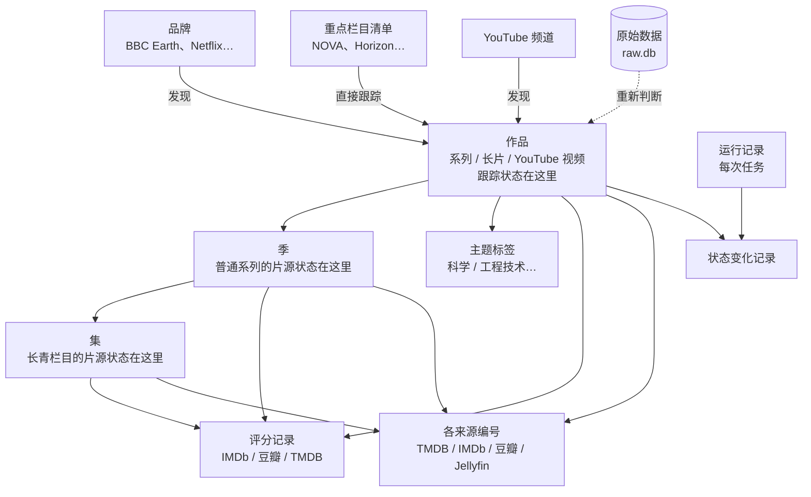
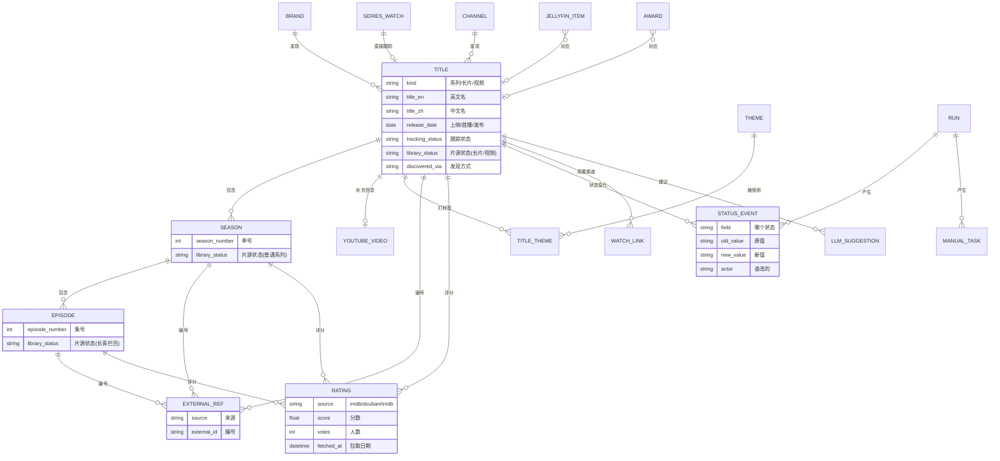

# 数据模型

> 阶段 2 的交付物之一。说明数据库里存什么、各部分怎么关联、两个状态怎么记、原始数据怎么存，以及每张表在哪个迭代建。
> 第 1 节是大白话的总览，看懂第 1 节就能判断设计对不对；第 2 节起是给开发用的细节。

---

## 1. 总览（先看这一节）

### 1.1 核心想法

1. **一张“作品”表装下所有类型**：电视系列、纪录长片、YouTube 视频都是“作品”，用“类型”区分。这样列表页、搜索、待下载页可以把三种放在一起筛选和排序。
2. **系列往下分“季”和“集”**：片源状态普通系列按季记，长青栏目（*NOVA*、*Horizon* 等）按集记，长片和 YouTube 视频按单条记（`requirements.md` 第 2 节）。
3. **各来源的编号单独记一张表**：同一部作品在 TMDB、IMDb、豆瓣、Jellyfin 里各有编号。豆瓣按季有不同编号，所以编号可以挂在作品、季或集上。
4. **评分每拉一次记一行**：带来源、分数、人数、拉取日期，网页显示最新一次；以前的记录保留，可以看出评分怎么变化。
5. **状态变化都留记录**：每次跟踪状态变化（谁改的、为什么、哪次任务）都记一行，报告里的“状态变化”就从这里来。
6. **原始数据另存一个文件**：各来源返回的原始数据原样存在单独的 `raw.db`。以后调主题规则或评分门槛，用存下的数据重新判断，不用重新抓（`plan.md` 第 1 节）。主数据库因此保持小巧，备份也快。
7. **配置文件是“清单”的唯一来源**：品牌、频道、重点栏目、主题、奖项名单都写在 `config/*.yaml` 里，每次运行时同步进数据库。要改清单就改配置文件，不在网页上改。

### 1.2 关系图（简化版）

### 1.3 一个例子

*Planet Earth III*（BBC Earth，2023）在数据库里是这样的：

| 记在哪 | 内容 |
|---|---|
| 作品 | 类型 = 系列；英文名 *Planet Earth III*，中文名《地球脉动 第三季》；品牌 = BBC Earth；发现方式 = 按品牌；跟踪状态 = 已收录 |
| 季 | 第 1 季，8 集；片源状态 = 已入库（Jellyfin 同步） |
| 各来源编号 | TMDB 剧集编号（挂在作品上）；IMDb `tt` 编号（挂在作品上）；豆瓣条目编号（挂在第 1 季上） |
| 评分记录 | IMDb 系列评分 + 人数 + 拉取日期（挂在作品上）；豆瓣评分 + 人数 + 拉取日期（挂在第 1 季上） |
| 主题 | 自然/地理 → 野生动物（来源：品牌默认主题） |
| 状态变化 | 2024-xx 待审核（双周任务发现）→ 已收录（你审核） |

*NOVA* 则是：作品 = 系列（长青栏目，发现方式 = 重点栏目），下面有几十季、每季十几集，**每一集**有自己的片源状态。

---

## 2. 实体详细说明

字段名用英文（代码里用），说明用中文。所有时间存 UTC。`id` 都是数据库内部编号。

### 2.1 清单类（从配置文件同步）

**brand 品牌**（`config/brands.yaml`）

| 字段 | 说明 |
|---|---|
| code | 编号，如 `UK-2`（对应 `scope.md` 第 2 节） |
| name | 名称 |
| start_year | 起始年份 |
| tmdb_networks / tmdb_companies | 对应的 TMDB 播出方 / 出品公司编号列表 |
| default_themes | 默认主题（单一主题品牌才设，如 NOVA 品牌 = 科学） |
| enabled | 是否收录 |

**series_watch 重点栏目**（`config/series.yaml`，`scope.md` 第 2.1 节）

| 字段 | 说明 |
|---|---|
| key | 简称，如 `horizon` |
| tmdb_tv_id | TMDB 剧集编号 |
| brand_code | 所属品牌（可空，如加拿大 Discovery 不在品牌表里） |
| themes | 预设主题 |
| per_episode | 是否按集记片源状态（长青栏目为是） |
| since_year | 从哪年起收（默认 2010） |

**channel YouTube 频道**（`config/channels.yaml`，`scope.md` 第 4 节）

| 字段 | 说明 |
|---|---|
| key / name | 简称 / 名称 |
| youtube_channel_id | 频道编号（`UC…`） |
| uploads_playlist_id | 上传列表编号（采集用） |
| channel_type | 官方 / 聚合 / 独立 |
| min_duration_min | 时长门槛（分钟）：官方和聚合 20，独立 5 |
| default_themes | 默认主题 |
| filters | 额外过滤提示，如“真实犯罪要过滤”“时政要过滤” |

**theme 主题**（`config/themes.yaml`，`scope.md` 第 6 节）：两级，大类（科学、工程技术…）和子类（宇宙/天文、制造业…）。

**award 奖项名单**（`config/awards.yaml`）：奥斯卡最佳纪录长片、金马奖最佳纪录片的提名和获奖，按年份手工维护（规则 C）。

**manual_include 手动收录**（`config/includes.yaml`）：2010 年前的高清经典（`scope.md` 第 5 节）等需要指定收录的作品，写 TMDB 编号。

### 2.2 作品、季、集

**title 作品**

| 字段 | 说明 |
|---|---|
| kind | 类型：`series` 系列 / `film` 长片 / `video` YouTube 视频 |
| title_en / title_zh / title_original | 英文名 / 中文名 / 原名 |
| original_language | 原始语种 |
| year / release_date | 年份；上映日期（长片）、首播日期（系列）、发布日期（视频） |
| overview_en / overview_zh | 简介 |
| runtime_min | 时长（长片、视频） |
| brand_id / channel_id / series_watch_id | 来自哪个品牌 / 频道 / 重点栏目（可空） |
| producers | 出品方标签（如 Silverback，只作标签，`scope.md` UK-5） |
| discovered_via | 发现方式：按品牌 / 重点栏目 / 频道 / 手动收录 / 奖项 / 人工补录 |
| tracking_status | 跟踪状态（第 3.1 节） |
| tracking_reason | 当前状态的理由，如“评分未达门槛：IMDb 6.8 / 320 人” |
| screen_suggestion | 初筛建议：收录 / 排除 / 空（判断不了，需人工）。只是建议，不直接改跟踪状态（迭代 1 加，见 `iterations/iter-1.md` 第 4 节） |
| screen_reasons | 初筛理由列表，如“主题：自然/地理（品牌默认）”“疑似真实犯罪：TMDB 关键词 murder” |
| upcoming_date | 待播作品的播出日期 |
| watch_until | `观察中` 的截止日期（上映日 + 12 个月） |
| library_status | 片源状态（只对长片、视频；系列的在季或集上） |
| poster_path | TMDB 海报路径 |

**season 季**

| 字段 | 说明 |
|---|---|
| title_id | 属于哪部系列 |
| season_number / name | 季号 / 季名 |
| air_date / episode_count | 首播日期 / 集数 |
| library_status | 片源状态（普通系列在这里记） |

**episode 集**

| 字段 | 说明 |
|---|---|
| season_id | 属于哪一季 |
| episode_number / name | 集号 / 集名（英文、中文） |
| air_date / runtime_min / overview | 播出日期 / 时长 / 简介 |
| library_status | 片源状态（长青栏目在这里记） |

**youtube_video YouTube 视频补充信息**（一对一挂在 `kind = video` 的作品上）

| 字段 | 说明 |
|---|---|
| video_id | 视频编号 |
| published_at | 发布时间 |
| duration_sec | 时长 |
| view_count / like_count / stats_at | 播放量、点赞数、统计时间（YouTube 没有评分，`scope.md` 第 7.1 节） |
| youtube_category | YouTube 分类（“新闻与政治”用来标出疑似时政） |

### 2.3 编号、主题、评分

**external_ref 各来源编号**

| 字段 | 说明 |
|---|---|
| entity_type / entity_id | 挂在哪：作品 / 季 / 集 |
| source | `tmdb` / `imdb` / `douban` / `youtube` / `jellyfin` |
| external_id | 该来源的编号 |
| match_method | 怎么对上的：来源自带 / 按编号 / 手动（暂不按标题自动对上） |

TMDB 的剧集、电影、季、集编号各自独立编号（剧集 1966 和电影 1966 是两部不同的片），所以 TMDB 编号存成带类别的形式：`tv/1966`、`movie/603`、`season/12345`、`episode/67890`。

同一个来源、同一个编号只能对应一个实体，防止重复。

**title_theme 作品的主题**

| 字段 | 说明 |
|---|---|
| title_id / theme_id | 作品 / 主题 |
| origin | 来源：品牌或频道默认 / 来源分类映射 / 关键词规则 / 大模型建议 / 人工 |
| confidence | 置信度（大模型建议才有） |
| confirmed | 是否经过人工确认 |

**rating 评分记录**

| 字段 | 说明 |
|---|---|
| entity_type / entity_id | 挂在作品 / 季 / 集上（IMDb 系列评分挂作品、单集评分挂集；豆瓣按季评分挂季） |
| source | `imdb` / `douban` / `tmdb` |
| score / votes | 分数 / 人数 |
| fetched_at | 拉取日期 |
| origin | 自动抓取 / 人工补录 |

每次拉取新增一行。只有分数或人数变化时才新增，没变化只更新“最近确认日期”，避免表无限增长。

### 2.4 流程类

**status_event 状态变化记录**

| 字段 | 说明 |
|---|---|
| entity_type / entity_id | 哪个作品（片源状态变化也记，可能挂季或集） |
| field | 跟踪状态 / 片源状态 |
| old_value / new_value | 改之前 / 改之后 |
| reason | 理由 |
| actor | 谁改的：系统 / 人工 / Jellyfin 同步 |
| run_id | 哪次任务改的（人工改为空） |
| at | 时间 |

**run 运行记录**（每次任务一行，`architecture.md` 第 6 节）

| 字段 | 说明 |
|---|---|
| task | `discover` / `refresh` / `backfill` / `sync-jellyfin` / … |
| trigger | 触发方式：定时 / 命令行 / 网页按钮 |
| params | 参数（来源、品牌、`--dry-run` 等） |
| status | 排队中 / 运行中 / 成功 / 部分失败 / 失败 |
| queued_at / started_at / finished_at | 时间 |
| progress | 当前进度（网页按钮显示用） |
| stats | 统计（新增数、各来源请求数、配额用量） |
| report_path | 报告文件路径 |

**source_checkpoint 各来源的进度**

| 字段 | 说明 |
|---|---|
| source / scope_key | 来源 + 范围（如 `tmdb` + `brand:UK-2`、`youtube` + `channel:veritasium`） |
| last_success_at | 上次成功检查到的时间（增量从这里开始） |
| backfill_cursor | 全量回溯的断点（年份、页码或翻页标记） |
| consecutive_failures / last_error | 连续失败次数 / 最近一次错误 |

按“来源 + 品牌/频道”分别记，所以一个频道失败不影响其他频道（`tracking.md` 第 3 节）。

**manual_task 人工处理事项**：需要你手动处理的事（豆瓣被拦截要补录、栏目页解析为 0 条等），带原因、产生它的任务、是否已处理。人工补录页就是这张表。

**jellyfin_item Jellyfin 条目**（迭代 4）：Jellyfin 里的条目（编号、名称、类型、季集号、自带的 TMDB / IMDb 编号）、对应到哪个作品/季/集、匹配方式、是否忽略。手动对应过的记住，以后自动用（场景 S8）。

**llm_suggestion 大模型建议**（迭代 6）：每次导入的批次、条目、建议主题、排除建议、理由、置信度。审核时作为建议显示，不直接改状态。

**watch_link 观看渠道**：作品的观看链接（YouTube 原始链接、平台链接）；电视台在 YouTube 上重新上传的某一集，可以作为观看渠道挂到对应作品下（`scope.md` 第 7.3 节）。

### 2.5 原始数据（`raw.db`，单独一个文件）

**raw_record**

| 字段 | 说明 |
|---|---|
| source / kind / external_id | 来源 / 数据种类（如 TMDB 剧集详情、季详情、YouTube 视频详情）/ 编号 |
| fetched_at | 抓取时间 |
| payload | 原始返回内容（压缩存储） |
| content_hash | 内容指纹，内容没变就不重复存 |

- 每个“来源 + 种类 + 编号”只保留最新一份（加上内容变化时的少量历史），控制体积。
- IMDb 数据包不进这里：数据包文件本身就保留在 `<DATA_DIR>/imdb/`，筛出的纪录片行写进 `rating`。
- 预估体积：TMDB 几千部作品的详情加 YouTube 几万条视频详情，压缩后几十到一两百 MB，SSD 上没有压力。

---

## 3. 两个状态的规则

### 3.1 跟踪状态（只在作品上）

取值：`待审核` / `已收录` / `已排除` / `观察中` / `待播`，流转见 `scenarios.md` 第 2.1 节。补充规则：

| 情况 | 规则 |
|---|---|
| 重点栏目、手动收录的作品 | 直接 `已收录`，不进审核 |
| 已收录系列的新一季、新一集 | 跟着系列，自动收录，只在报告里列出（不单独记跟踪状态） |
| 纪录长片，上映不满 12 个月、评分未达门槛 | `观察中`，记 `watch_until` |
| 纪录长片，上映已满 12 个月、评分未达门槛（多见于全量回溯的历史片） | 直接 `已排除`，理由写明分数和人数；以后获奖仍可按规则 C 收录 |
| 已排除的作品再次被发现 | 不再提示（除非规则 C 命中或你手动改） |
| 规则调整后重新判断（`doc reclassify`） | 只改系统判断的状态；**你人工确认过的不动** |

### 3.2 片源状态

取值：`未入库` / `计划中` / `已入库`，流转见 `scenarios.md` 第 2.2 节。

| 作品类型 | 记在哪 | 作品整体显示 |
|---|---|---|
| 纪录长片、YouTube 视频 | 作品 | 本身的状态 |
| 普通系列 | 每一季 | 按季汇总：全部已入库 / “3/5 季已入库” / 未入库 |
| 长青栏目（`per_episode`） | 每一集 | 按集汇总：“已入库 42 集” |

- 只有 `已收录` 的作品才显示片源状态。
- 手动改和 Jellyfin 同步都会记进 `status_event`，能看出是谁改的。
- 手动标记的 `已入库`，Jellyfin 同步不会改回 `未入库`；只有 Jellyfin 同步自己设的 `已入库`，才会在 Jellyfin 里删除后改回（避免同步覆盖你的手动标记）。

---

## 4. 其他设计决定

| 问题 | 决定 |
|---|---|
| 搜索 | 中英文标题搜索。SQLite 全文检索对中文两字词支持不好，所以三个字以上用全文检索，一两个字用普通模糊匹配；数据量几万条，速度都够 |
| 去重 | 第一步不做（`scope.md` 第 1 节）。同一个来源同一个编号只建一条作品，避免同一部作品被不同品牌重复发现 |
| 删除 | 不物理删除作品；来源里消失的作品标记一下，保留记录 |
| 表结构变更 | 一律通过 Alembic 迁移（`architecture.md` 第 1 节），升级前自动备份 |

---

## 5. 每张表在哪个迭代建

| 迭代 | 新建的表 |
|---|---|
| 0 骨架 | `run` |
| 1 TMDB 小范围 | `brand`、`series_watch`、`theme`、`title`、`season`、`episode`、`external_ref`、`title_theme`、`status_event`、`source_checkpoint`、`rating`（先只存 TMDB 评分）、`raw_record`（`raw.db`） |
| 2a TMDB + IMDb | `award`、`manual_include`（`rating` 开始存 IMDb 评分） |
| 2b YouTube | `channel`、`youtube_video`、`watch_link` |
| 2c 豆瓣 + 中文平台 | `manual_task` |
| 3 定期更新 | `run` 增加排队、进度字段 |
| 4 Jellyfin | `jellyfin_item` |
| 6 批量审核 + 大模型 | `llm_suggestion` |

---

## 6. 完整关系图（开发用）

---

## 7. 确认记录

- 整体设计已确认。
- 手动标记的 `已入库` 不会被 Jellyfin 同步改回（第 3.2 节）。
- 个人备注、想看优先级、看过没看过：暂不加，记进 `plan.md` 待办清单。
- 迭代 1 开始时确认（2026-10-29）：`title` 加 `screen_suggestion` / `screen_reasons`；`rating` 表提前到迭代 1 建，先只存 TMDB 评分。
