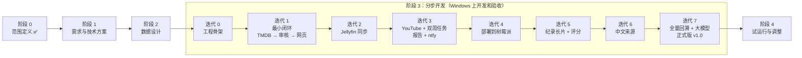

# 整体计划与交付物

> **核心原则：不一次性把所有功能做完，而是分成多个小版本（迭代），每个迭代做出一个能实际用起来的场景，测试通过、你验收后再做下一个。**
> 开发流程的具体规范（分支、测试、验收怎么做）见 `process.md`；使用场景见 `scenarios.md`。
>
> **每个阶段 / 迭代的沟通方式**：
> - **开始时**：先说明要做什么、主要交付物有哪些、需要你提供或决定什么。
> - **结束时**：列出交付物清单和需要你确认的问题，确认后再进入下一步。

---

## 1. 为什么要分步做

如果按“先把所有来源都采集完 → 再做审核 → 再做网页”的顺序（原来的计划），要等到最后才能第一次用上，中间任何一步的问题（比如数据结构设计得不好用）都要到最后才发现，返工代价很大。

改成**按场景分步**：

- 第一个迭代就做出一条**从头到尾走得通的最小流程**：从 TMDB 拿几个品牌的片 → 审核 → 在网页上看到 → 标记片源状态。数据量小，但每个环节都有。
- 之后每个迭代**加一个来源或一个场景**，每次都能马上用、马上测。
- 先用少量品牌和频道验证，**全量回溯放到后面**：规则和数据结构在小数据上调好了，再一次性跑大数据，避免在几千条数据上反复返工。

---

## 2. 总览

| 阶段 / 迭代 | 内容 | 完成后你能做什么 | 版本 | 状态 |
|---|---|---|---|---|
| 阶段 0 | 范围定义 | — | — | ✅ 完成 |
| 阶段 1 | 需求、场景、技术方案、开发计划 | — | — | 进行中 |
| 阶段 2 | 数据设计 | — | — | |
| 迭代 0 | 工程骨架 | 在 Windows 上装好并打开一个空网页 | v0.0 | |
| 迭代 1 | 最小闭环：TMDB（2–3 个品牌）→ 审核 → 网页 | 浏览、搜索、审核、手动标记片源状态、看待下载清单 | v0.1 | |
| 迭代 2 | Jellyfin 同步 | 已下载的片自动变成 `已入库` | v0.2 | |
| 迭代 3 | YouTube + 双周任务 + 报告 + ntfy | 收到推送、看报告、审核新内容；看最近新出品 | v0.3 | |
| 迭代 4 | 部署到树莓派 + 定时任务 | **开始日常使用**：任务每两周自动跑 | v0.4 | |
| 迭代 5 | 纪录长片 + IMDb 评分 + 观察中 + 月度刷新 | 按评分门槛收录长片 | v0.5 | |
| 迭代 6 | 豆瓣 + 中文平台 + 人工补录 | 中文纪录片和豆瓣评分 | v0.6 | |
| 迭代 7 | 全部品牌/频道 + 全量回溯 + 大模型标定 + 批量审核 | 完整数据 | v1.0 | |
| 阶段 4 | 试运行与调整 | — | v1.x | |

**为什么是这个顺序**
- 迭代 1–3 覆盖最核心的用法（挑片下载、双周审核），越早用上越早发现问题。
- 迭代 4 **提前部署到树莓派**：尽早暴露 ARM、内存、代理这类只在树莓派上才有的问题；之后的迭代在 Windows 上开发验收，再更新到树莓派。
- 迭代 5（IMDb 数据包较大）放在部署之后，可以直接在树莓派上验证内存是否在预算内。
- 迭代 6（豆瓣、中文平台）最不稳定，放在主流程稳定之后。
- 迭代 7 最后做全量：前面的规则已经在小数据上调好了。

---

## 3. 阶段 1：需求与技术方案

**要做什么**：确定做什么（需求、场景）、怎么做（技术方案）、按什么顺序做（本计划）。

**交付物**

| 文件 | 内容 | 状态 |
|---|---|---|
| `requirements.md` | 功能清单、部署环境、大模型模块 | ✅ 已确认 |
| `scenarios.md` | 使用场景、场景流程图、状态流转图、页面清单 | 草稿，待确认 |
| `architecture.md` | 技术选型、功能架构图、运行结构、部署结构、模块划分、报告与推送、密钥管理 | 技术选型已确认；新增的架构图待确认 |
| `plan.md`（本文） | 分步开发计划 | 待确认 |
| `process.md` | 开发流程规范：分支、版本、测试、验收、变更管理、风险 | 待确认 |

**已确认**
- 仅个人使用；不做登录，只限内网和 Tailscale
- 树莓派 4 / 4GB / Debian / Docker，整个系统在 SSD 上；媒体服务器 Jellyfin
- 技术选型：Python + FastAPI + SQLite + htmx，定时任务用树莓派 cron
- 每次任务生成详细报告，并通过 ntfy 推送简要信息
- 分步实现、按场景测试

**完成标准**：你确认以上五份文档。

---

## 4. 阶段 2：数据设计

**要做什么**：设计数据库里存什么、怎么关联。**数据模型一次设计完整**（覆盖所有来源和场景），但**实现时按迭代逐步建表**，每个迭代只建它用到的部分。这样后面的迭代不会推翻前面的结构。

**交付物**
- `docs/data-model.md`：数据实体和关系图
  - 作品（系列 / 长片）、季、集；品牌、出品方、播出方；YouTube 频道、视频
  - 主题标签；评分记录（来源、分数、人数、拉取日期）
  - 跟踪状态、片源状态及其流转规则；各来源的检查时间；运行记录
  - 每张表在哪个迭代建
- `docs/source-mapping.md`：TMDB、IMDb、豆瓣、YouTube、Jellyfin 的字段如何对应到数据模型
- `config/brands.yaml`、`config/channels.yaml` 的**格式**，以及迭代 1、3 要用的少量品牌/频道（ID 查好核对过）。其余的在迭代 7 补全。

**你需要做的**：确认数据模型。
**完成标准**：你确认数据模型；试点品牌和频道的 ID 已核对。

---

## 5. 阶段 3：分步开发

每个迭代都按同样的步骤走（详见 `process.md` 第 2 节）：

每个迭代有一份 `docs/iterations/iter-N.md`：开始时写计划（目标、功能、验收场景），结束时记验收结果。

### 迭代 0：工程骨架（v0.0）

**目标**：把“能写代码、能运行、能测试”的基础搭好，在你电脑上验证环境没问题。

| 内容 | 说明 |
|---|---|
| 项目结构 | 按 `architecture.md` 第 4 节建目录；`pyproject.toml`、`.gitattributes`、`.env.example` |
| 配置加载 | 读 `.env` 和 `config/*.yaml`，缺项时报清楚的错 |
| 数据库 | SQLite + Alembic 迁移框架（先建一张运行记录表） |
| 命令行 | `doc` 命令入口，先有 `doc version`、`doc check-config` |
| 网页 | 能打开一个空首页 |
| 测试 | pytest、ruff 跑通；GitHub Actions 在每次推送时自动跑测试 |

**验收场景**：你在 Windows 上按 README 的步骤安装 → `doc check-config` 通过 → 浏览器打开首页。
**你需要做的**：在电脑上装 uv（README 里会写清楚步骤）。

### 迭代 1：最小闭环（v0.1）

**目标**：一条最小但完整的流程：采集 → 初筛 → 审核 → 浏览 → 标记片源状态。

| 内容 | 说明 |
|---|---|
| TMDB 采集 | 只做 2–3 个品牌（建议 BBC Earth、PBS NOVA、Netflix），电视系列 + 季 + 集 |
| 手动更新命令 | `doc discover --source tmdb`，支持 `--brand`、`--dry-run`（场景 S0 命令行版） |
| 初筛 | 品牌默认主题、TMDB 关键词规则；跟踪状态 `待审核` → `已收录` / `已排除` |
| 审核页 | 逐条和按品牌整组收录/排除 |
| 网页 | 首页（简单统计）、作品列表、详情、搜索、待下载 |
| 片源状态 | 手动标记 `未入库` / `计划中` / `已入库`，系列按季 |

**验收场景**：S0（命令行版：先 `--dry-run` 预览，再正式运行）、S1（手动标记版）、S2 的审核部分、S4（见 `scenarios.md`）。
**你需要做的**：申请 TMDB API key；用几天，告诉我哪里不好用。

### 迭代 2：Jellyfin 同步（v0.2）

| 内容 | 说明 |
|---|---|
| 同步 | 按 TMDB / IMDb 编号匹配，再按标题；`--dry-run` 预览；`--save-snapshot` 存快照 |
| 未匹配页 | 手动指定对应关系，并记住 |

**验收场景**：S1 自动入库那一步、S8。
**你需要做的**：在 Jellyfin 后台生成 API key；电脑开着 Tailscale。

### 迭代 3：YouTube + 双周任务 + 报告 + 推送（v0.3）

| 内容 | 说明 |
|---|---|
| YouTube 采集 | 先做约 10 个频道（单一主题、综合、聚合各几个），时长门槛、频道默认主题 |
| 双周任务 | `doc discover`：TMDB + YouTube 的增量发现、已收录系列的新季/新集、待播；各来源分别记检查时间 |
| 运行报告 | 报告文件 + 运行记录页（`architecture.md` 第 6.1 节） |
| ntfy 推送 | 简要推送 + 连续失败告警（第 6.2 节） |
| 最近新出品页 | 按双周周期展示 |
| 立即更新按钮 | 首页和运行记录页；选任务和来源；运行中显示进度；Windows 上用子进程方式运行（`architecture.md` 第 6.3 节） |

**验收场景**：S0（按钮版和 14 天判断）、S2 完整流程、S5；另外故意断开代理，验证失败报告和告警。
**你需要做的**：申请 YouTube Data API key；手机装 ntfy 并订阅 topic。

### 迭代 4：部署到树莓派（v0.4）

| 内容 | 说明 |
|---|---|
| Docker | Dockerfile、docker-compose.yml（含内存上限），在树莓派上构建 |
| 定时任务 | cron：双周发现、每日 Jellyfin 同步、每日备份；任务锁 |
| 手动运行 | 包装脚本 `./doc <命令>`；网页按钮的请求排队脚本（cron 每分钟检查） |
| 迁移 | 把 Windows 上的数据库拷过去，验证数据一致 |
| 运维说明 | `docs/operations.md`：怎么更新版本、看日志、恢复备份、回退到上个版本 |

**验收场景**：任务按时自动运行，你收到推送；SSH 运行 `./doc discover --dry-run` 正常；手机点“立即更新”，一分钟内开始运行、跑完收到推送；内存在预算内。
**你需要做的**：给我树莓派的 SSH 访问方式（或者你按我写的步骤执行命令）。
**从这个迭代开始，应用进入日常使用。**

### 迭代 5：纪录长片 + 评分（v0.5）

| 内容 | 说明 |
|---|---|
| TMDB 纪录长片发现 | `discover/movie` |
| IMDb 数据包 | 流式处理，评分写入评分记录 |
| 评分门槛 | `scope.md` 第 3 节规则 A、C（奖项先用手工维护的名单） |
| 观察中 + 月度刷新 | `doc refresh`，满 12 个月转 `已排除` |
| 详情页 | 显示各来源评分和“截至某年某月” |

**验收场景**：S6；在树莓派上跑一次 `doc refresh`，峰值内存在 300MB 内。

### 迭代 6：中文来源（v0.6）

| 内容 | 说明 |
|---|---|
| 豆瓣 | 低频抓取评分（规则 B），被拦截时进入人工补录 |
| 中文平台栏目页 | 先做央视网纪录频道，再按需加 |
| 人工补录页 | 手动填写或导入文件 |

**验收场景**：S7。

### 迭代 7：全量回溯 + 大模型标定 + 正式版（v1.0）

| 内容 | 说明 |
|---|---|
| 配置补全 | `scope.md` 里所有品牌、频道的 ID 查好核对 |
| 全量回溯 | `doc backfill`，分段、可断点续跑 |
| 回溯报告 | `reports/backfill-report.md`：每品牌/频道/年的数量、评分门槛命中情况、失败清单 |
| 大模型标定 | 导出 / 导入 / 提示词 |
| 批量审核 | 按建议和置信度筛选、整组确认、审核进度 |

**验收场景**：S3；你确认回溯报告，评分门槛如需调整就调整。
**你需要做的**：首轮审核（量大，可以分多次）。

---

## 6. 阶段 4：试运行与调整

试运行一到两个月，观察并调整：评分门槛、时长门槛、品牌和频道增减、主题规则和大模型准确率、审核工作量。

**交付物**：`reports/trial-report.md`、`docs/scope.md` v2。

---

## 7. 待办清单（以后再说的想法）

开发过程中冒出来的新想法记在这里，排进后面的迭代，**不在当前迭代中途插入**（见 `process.md` 第 5 节）。

- `计划中` 的作品一键推送到 qBittorrent（`requirements.md` 第 6 节）
- 去重合并（`scope.md` 第 7.3 节）
- 自建 ntfy

---

## 8. 你需要准备的

| 什么 | 什么时候需要 |
|---|---|
| 电脑上装 uv（Python 环境管理工具，步骤会写在 README） | 迭代 0 |
| TMDB API key | 迭代 1 |
| Jellyfin API key；电脑上开着 Tailscale | 迭代 2 |
| YouTube Data API key（Google Cloud）；手机装 ntfy | 迭代 3 |
| 树莓派的 Tailscale + SSH 访问 | 迭代 4 |
