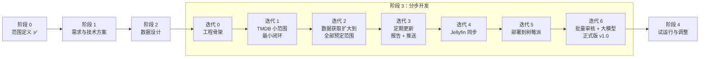
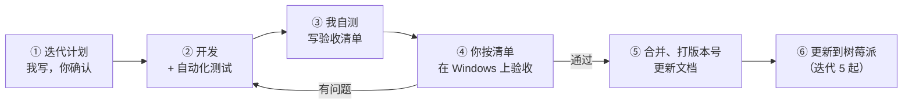

# 整体计划与交付物

> **核心原则：不一次性把所有功能做完，而是分成多个小版本（迭代），每个迭代做出一个能实际用起来的场景，测试通过、你验收后再做下一个。**
> 开发流程的具体规范（分支、测试、验收怎么做）见 `process.md`；使用场景见 `scenarios.md`；分几个会话做、每个会话怎么开始见 `sessions.md`。**下一步做什么见第 9 节。**
>
> **每个阶段 / 迭代的沟通方式**：
> - **开始时**：先说明要做什么、主要交付物有哪些、需要你提供或决定什么。
> - **结束时**：列出交付物清单和需要你确认的问题，确认后再进入下一步。

---

## 1. 为什么这样分步

整个项目最大的基础是**数据获取**：数据拿不全、拿不准，后面的审核、网页、片源同步都没有意义。数据获取也是风险最大的部分（TMDB 中文片覆盖不全、豆瓣风控、品牌/频道 ID 难查、YouTube 配额）。软件开发的通常做法是**先解决风险最大的部分**，所以：

1. **迭代 1：先用 TMDB 小范围走通**。只做 2–3 个品牌，从采集到网页走通一条最小但完整的流程，验证数据结构和基本流程是对的。
2. **迭代 2：数据获取扩大到全部预定范围**。按来源分三步（TMDB + IMDb → YouTube → 豆瓣 + 中文平台），把 `scope.md` 里所有品牌、频道、纪录长片都跑一遍全量回溯，出覆盖报告，由你核对数据全不全、门槛合不合适。
3. **之后再做业务功能**：Jellyfin 同步、定期更新与推送、部署到树莓派、批量审核和大模型标定。这时数据基础已经验证过，后面的功能不会因为数据问题返工。

**全量数据提前跑，规则以后还会调怎么办？** 采集时把各来源的**原始数据也存下来**。以后调整主题规则、评分门槛，只需要用存下来的数据重新跑一遍判断（`doc reclassify`），不用重新抓取。

---

## 2. 总览

| 阶段 / 迭代 | 内容 | 完成后你能做什么 | 版本 | 状态 |
|---|---|---|---|---|
| 阶段 0 | 范围定义 | — | — | ✅ 完成 |
| 阶段 1 | 需求、场景、技术方案、开发计划 | — | — | 进行中 |
| 阶段 2 | 数据设计 | — | — | |
| 迭代 0 | 工程骨架 | 在 Windows 上装好并打开一个空网页 | v0.0 | |
| 迭代 1 | TMDB 小范围（2–3 个品牌）→ 审核 → 网页 | 手动更新数据；浏览、搜索、审核、标记片源状态、看待下载清单 | v0.1 | |
| 迭代 2 | **数据获取扩大到全部预定范围**：2a TMDB 全部品牌 + 纪录长片 + IMDb 评分；2b YouTube 全部频道；2c 豆瓣 + 中文平台 | 看到完整范围的数据和覆盖报告，按品牌整组审核 | v0.2 | |
| 迭代 3 | 定期更新：双周增量、新季、待播、月度评分刷新、报告、ntfy、立即更新按钮 | 收到推送、看报告、审核新内容；看最近新出品 | v0.3 | |
| 迭代 4 | Jellyfin 同步 | 已下载的片自动变成 `已入库` | v0.4 | |
| 迭代 5 | 部署到树莓派 + 定时任务 | **开始日常使用**：任务自动定时跑 | v0.5 | |
| 迭代 6 | 批量审核工具 + 大模型标定 | 高效完成首轮审核 | v1.0 | |
| 阶段 4 | 试运行与调整 | — | v1.x | |

**为什么是这个顺序**
- 迭代 1 用小数据验证流程和数据结构，迭代 2 马上把数据获取扩到全范围：**最大的风险最先暴露**。门槛、品牌、频道要调整的话，也在这时就调，不用等到最后。
- 迭代 3 先让数据**自动保持最新**（定期更新、报告、推送），这是数据基础的延续。
- 迭代 4 再做 Jellyfin 同步：它只影响片源状态，在这之前用手动标记就够用。
- 迭代 5 部署到树莓派：功能齐了再迁移，数据库直接拷过去。内存、ARM、代理这些问题在这一步集中验证。
- 迭代 6 的批量审核和大模型标定是“提高效率”的功能：迭代 2 起已经能用按品牌整组审核的方式处理数据，所以放在最后。

## 3. 阶段 1：需求与技术方案

**要做什么**：确定做什么（需求、场景）、怎么做（技术方案）、按什么顺序做（本计划）。

**交付物**

| 文件 | 内容 | 状态 |
|---|---|---|
| `requirements.md` | 功能清单、部署环境、大模型模块 | ✅ 已确认 |
| `scenarios.md` | 使用场景、场景流程图、状态流转图、页面清单 | 草稿，待确认 |
| `architecture.md` | 技术选型、功能架构图、运行结构、部署结构、模块划分、报告与推送、密钥管理 | 技术选型已确认；新增的架构图待确认 |
| `plan.md`（本文） | 分步开发计划 | 待确认 |
| `process.md` | 开发流程规范：分支、版本、测试、验收、变更管理、风险 | 待确认 |

**已确认**
- 仅个人使用；不做登录，只限内网和 Tailscale
- 树莓派 4 / 4GB / Debian / Docker，整个系统在 SSD 上；媒体服务器 Jellyfin
- 技术选型：Python + FastAPI + SQLite + htmx，定时任务用树莓派 cron
- 每次任务生成详细报告，并通过 ntfy 推送简要信息
- 分步实现、按场景测试

**完成标准**：你确认以上五份文档。

---

## 4. 阶段 2：数据设计

**要做什么**：设计数据库里存什么、怎么关联。**数据模型一次设计完整**（覆盖所有来源和场景），但**实现时按迭代逐步建表**，每个迭代只建它用到的部分。这样后面的迭代不会推翻前面的结构。

**交付物**
- `docs/data-model.md`：数据实体和关系图
  - 作品（系列 / 长片）、季、集；品牌、出品方、播出方；YouTube 频道、视频
  - 主题标签；评分记录（来源、分数、人数、拉取日期）
  - 跟踪状态、片源状态及其流转规则；各来源的检查时间；运行记录
  - 每张表在哪个迭代建
- `docs/source-mapping.md`：TMDB、IMDb、豆瓣、YouTube、Jellyfin 的字段如何对应到数据模型
- `config/brands.yaml`、`config/channels.yaml` 的**格式**，以及迭代 1 要用的 2–3 个品牌（ID 查好核对过）。其余的在迭代 2 补全。
- 原始数据怎么存（为了以后调规则时不用重新抓取）

**你需要做的**：确认数据模型。
**完成标准**：你确认数据模型；试点品牌和频道的 ID 已核对。

---

## 5. 阶段 3：分步开发

每个迭代都按同样的步骤走（详见 `process.md` 第 2 节）：

每个迭代有一份 `docs/iterations/iter-N.md`：开始时写计划（目标、功能、验收场景），结束时记验收结果。

### 迭代 0：工程骨架（v0.0）

**目标**：把“能写代码、能运行、能测试”的基础搭好，在你电脑上验证环境没问题。

| 内容 | 说明 |
|---|---|
| 项目结构 | 按 `architecture.md` 第 4 节建目录；`pyproject.toml`、`.gitattributes`、`.env.example` |
| 配置加载 | 读 `.env` 和 `config/*.yaml`，缺项时报清楚的错 |
| 数据库 | SQLite + Alembic 迁移框架（先建一张运行记录表） |
| 命令行 | `doc` 命令入口，先有 `doc version`、`doc check-config` |
| 网页 | 能打开一个空首页 |
| 测试 | pytest、ruff 跑通；GitHub Actions 在每次推送时自动跑测试 |

**验收场景**：你在 Windows 上按 README 的步骤安装 → `doc check-config` 通过 → 浏览器打开首页。
**你需要做的**：在电脑上装 uv（README 里会写清楚步骤）。

### 迭代 1：最小闭环（v0.1）

**目标**：一条最小但完整的流程：采集 → 初筛 → 审核 → 浏览 → 标记片源状态。

| 内容 | 说明 |
|---|---|
| TMDB 采集 | 只做 2–3 个品牌（建议 BBC Earth、PBS NOVA、Netflix），电视系列 + 季 + 集 |
| 手动更新命令 | `doc discover --source tmdb`，支持 `--brand`、`--dry-run`（场景 S0 命令行版） |
| 初筛 | 品牌默认主题、TMDB 关键词规则；跟踪状态 `待审核` → `已收录` / `已排除` |
| 审核页 | 逐条和按品牌整组收录/排除 |
| 网页 | 首页（简单统计）、作品列表、详情、搜索、待下载 |
| 片源状态 | 手动标记 `未入库` / `计划中` / `已入库`，系列按季 |

**验收场景**：S0（命令行版：先 `--dry-run` 预览，再正式运行）、S1（手动标记版）、S2 的审核部分、S4（见 `scenarios.md`）。
**你需要做的**：申请 TMDB API key；用几天，告诉我哪里不好用。

### 迭代 2：数据获取扩大到全部预定范围（v0.2）

**目标**：把 `scope.md` 定下的全部范围都采集一遍（全量回溯），确认数据**拿得全、拿得准、拿得稳**。这是整个项目的数据基础。

按来源分三步做，**每一步单独验收**，前一步通过再做下一步：

| 步骤 | 内容 | 主要风险 |
|---|---|---|
| **2a** TMDB + IMDb | 全部电视/流媒体品牌（`scope.md` 第 2 节）的系列、季、集；纪录长片发现；IMDb 数据包（流式处理）补评分；纪录长片评分门槛规则 A、C（奖项先用手工名单）；2010 年前高清经典逐部核对 | 品牌对应的 TMDB 播出方/公司 ID 查不准；IMDb 数据包大 |
| **2b** YouTube | 全部频道（`scope.md` 第 4 节）的历史视频；时长门槛；频道默认主题 | 配额（大频道分多天跑）；频道 ID |
| **2c** 豆瓣 + 中文平台 | 中文片、中文系列的豆瓣评分（规则 B，按季）；央视网等栏目页；**人工补录页**（被拦截或抓不到的手动补） | 豆瓣风控；TMDB 中文覆盖不全 |

每一步都包括：

| 内容 | 说明 |
|---|---|
| 配置补全 | 这一步涉及的品牌/频道 ID 全部查好，你核对 |
| 全量回溯 | `doc backfill --source xxx`：分品牌/频道、分年份，**可断点续跑**（中途失败或跑到配额上限，下次从断点继续） |
| 原始数据保存 | 各来源返回的原始数据存下来；`doc reclassify` 用存下的数据重新跑初筛和门槛判断，不用重新抓 |
| 失败记录 | 每个来源、每个品牌/频道的失败都记下来，可以单独重跑 |
| 运行记录页 | 网页上查看每次回溯的结果和失败清单 |
| 覆盖报告 | `reports/backfill-report.md` 中这一步的部分（见下） |

**覆盖报告**（`reports/backfill-report.md`）回答“数据全不全、准不准”：
- 每个品牌、频道、每年的条目数量，和预期明显不符的标出来（如某品牌某年为 0）
- **名作核对清单**：事先列出约 50 部你熟悉的代表作（如 *Planet Earth II*、*Free Solo*、*My Octopus Teacher*、《舌尖上的中国》、《河西走廊》），逐一检查有没有采集到、评分对不对。这是检验“拿得全”最直接的办法
- 纪录长片评分门槛的命中情况：每年多少部达标、漏掉的名作、混进来的冷门片
- 抓取失败、需要人工补录的清单

**验收场景**：S0（全量回溯版）、S3 的数据部分（按品牌整组审核）、S6 的门槛判断、S7（失败与人工补录）。
**你需要做的**：核对品牌/频道 ID；提供或确认名作核对清单；看覆盖报告，决定门槛和范围要不要调。
**完成标准**：三步都验收通过；覆盖报告经你确认；门槛如需调整已调整（`scope.md` 同步更新）。

### 迭代 3：定期更新 + 报告 + 推送（v0.3）

| 内容 | 说明 |
|---|---|
| 双周任务 | `doc discover`：全部来源的增量发现、已收录系列的新季/新集、待播；各来源分别记检查时间；14 天判断 |
| 月度任务 | `doc refresh`：刷新 12 个月内作品评分；`观察中` 达到门槛转 `待审核`，满 12 个月转 `已排除` |
| 运行报告 | 完整报告内容（`architecture.md` 第 6.1 节） |
| ntfy 推送 | 简要推送 + 连续失败告警（第 6.2 节） |
| 最近新出品页 | 按双周周期展示 |
| 立即更新按钮 | 首页和运行记录页；选任务和来源；运行中显示进度；Windows 上用子进程方式运行（第 6.3 节）。先只有“发现新内容 / 刷新评分”两个选项，“同步 Jellyfin”在迭代 4 加 |

**验收场景**：S0（按钮版和 14 天判断）、S2 完整流程、S5、S6（观察中和月度刷新）；另外故意断开代理，验证失败报告和告警。
**你需要做的**：手机装 ntfy 并订阅 topic。

### 迭代 4：Jellyfin 同步（v0.4）

| 内容 | 说明 |
|---|---|
| 同步 | 按 TMDB / IMDb 编号匹配，再按标题；`--dry-run` 预览；`--save-snapshot` 存快照 |
| 未匹配页 | 手动指定对应关系，并记住 |
| 立即更新按钮 | 加上“同步 Jellyfin”选项 |
| 定时任务 | 每日同步加入定时任务配置（树莓派上的 cron 在迭代 5 配置） |

**验收场景**：S1 自动入库那一步、S8。
**你需要做的**：在 Jellyfin 后台生成 API key；电脑开着 Tailscale。

### 迭代 5：部署到树莓派（v0.5）

| 内容 | 说明 |
|---|---|
| Docker | Dockerfile、docker-compose.yml（含内存上限），在树莓派上构建 |
| 定时任务 | cron：双周发现、月度刷新、每日 Jellyfin 同步、每日备份；任务锁 |
| 手动运行 | 包装脚本 `./doc <命令>`；网页按钮的请求排队脚本（cron 每分钟检查） |
| 迁移 | 把 Windows 上的数据库拷过去，验证数据一致 |
| 运维说明 | `docs/operations.md`：怎么更新版本、看日志、恢复备份、回退到上个版本 |

**验收场景**：任务按时自动运行，你收到推送；SSH 运行 `./doc discover --dry-run` 正常；手机点“立即更新”，一分钟内开始运行、跑完收到推送；在树莓派上跑一次 `doc refresh`，峰值内存在 300MB 内，网页常驻在 150MB 内。
**你需要做的**：给我树莓派的 SSH 访问方式（或者你按我写的步骤执行命令）。
**从这个迭代开始，应用进入日常使用。**

### 迭代 6：批量审核 + 大模型标定 + 正式版（v1.0）

| 内容 | 说明 |
|---|---|
| 大模型标定 | 导出 / 导入 / 提示词（`architecture.md` 第 8 节） |
| 批量审核 | 按建议和置信度筛选、整组确认、审核进度 |

**验收场景**：S3 完整流程。
**你需要做的**：完成首轮审核（量大，可以分多次）。

---

## 6. 阶段 4：试运行与调整

试运行一到两个月，观察并调整：评分门槛、时长门槛、品牌和频道增减、主题规则和大模型准确率、审核工作量。

**交付物**：`reports/trial-report.md`、`docs/scope.md` v2。

---

## 7. 待办清单（以后再说的想法）

开发过程中冒出来的新想法记在这里，排进后面的迭代，**不在当前迭代中途插入**（见 `process.md` 第 5 节）。

- `计划中` 的作品一键推送到 qBittorrent（`requirements.md` 第 6 节）
- 去重合并（`scope.md` 第 7.3 节）
- 自建 ntfy

---

## 8. 你需要准备的

| 什么 | 什么时候需要 |
|---|---|
| 电脑上装 uv（Python 环境管理工具，步骤会写在 README） | 迭代 0 |
| TMDB API key | 迭代 1 |
| YouTube Data API key（Google Cloud）；核对品牌/频道 ID；名作核对清单 | 迭代 2 |
| 手机装 ntfy | 迭代 3 |
| Jellyfin API key；电脑上开着 Tailscale | 迭代 4 |
| 树莓派的 Tailscale + SSH 访问 | 迭代 5 |

---

## 9. 下一步

**当前位置**：阶段 1 收尾（会话 A，见 `sessions.md`）。

1. **你确认阶段 1 剩下的问题**：
   - 迭代顺序（本文第 2 节）
   - 开发流程规范（`process.md`）
   - 场景和页面清单（`scenarios.md` 第 5 节）
   - ntfy 先用公共的 ntfy.sh
   - 已收录系列的新一季是否自动收录
2. **合并到 `main`**：我把你的答复写进文档，开合并请求，你在 GitHub 上点“合并”。阶段 1 结束。
3. **开会话 B：阶段 2 数据设计**。交付 `data-model.md`（实体关系图、原始数据怎么存、每张表在哪个迭代建）、`source-mapping.md`、`config/brands.yaml` / `channels.yaml` 的格式和试点品牌的 ID。开场白见 `sessions.md` 第 5 节。
4. **你可以同时准备**：
   - TMDB API key（迭代 1 要用）
   - 名作核对清单的初稿（迭代 2 要用）
   - 想好以后用云端会话还是在 Windows 上用 Claude Code（`sessions.md` 第 4 节）

