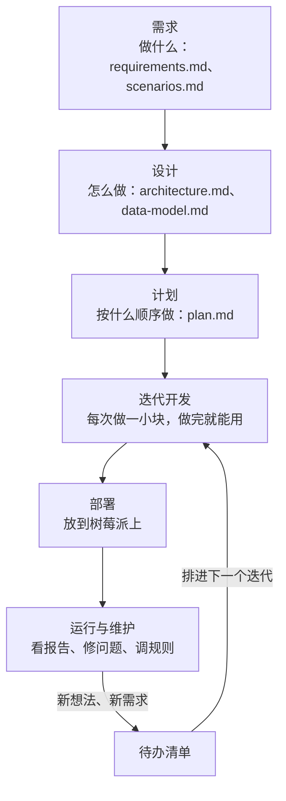

# 开发流程规范

> 这份文档说明这个项目**按什么规矩开发**：每个迭代怎么走、代码怎么管理、怎么测试、你怎么验收、出了问题怎么回退。
> 写给不是软件开发专家的你：每一项都说明“是什么”和“为什么要这样”。

---

## 1. 整体流程

软件开发的标准做法是先想清楚再动手，动手时小步快跑：



- **需求、设计、计划**是阶段 0–2，产出都是文档，你确认后才写代码。
- **迭代开发**是阶段 3，按 `plan.md` 分成 7 个迭代（迭代 0–6），先把数据获取做扎实，再做业务功能。
- 文档不是写完就不管：做的过程中有任何决定改了，**先改文档，再改代码**，文档始终反映当前的真实情况。

---

## 2. 每个迭代怎么走

| 步骤 | 谁做 | 做什么 | 产出 |
|---|---|---|---|
| ① 迭代计划 | 我写，你确认 | 这个迭代的目标、包含的功能、不包含的功能、验收场景、需要你准备什么 | `docs/iterations/iter-N.md` 的计划部分 |
| ② 开发 | 我 | 写代码，同时写自动化测试 | 代码 + 测试 |
| ③ 自测 | 我 | 自动化测试全部通过；自己按验收场景走一遍；写出**验收清单** | 验收清单（一步一步怎么操作、应该看到什么） |
| ④ 验收 | 你 | 在 Windows 上按清单操作，记下不对的地方 | 问题清单 |
| ⑤ 修复 | 我 | 修完再给你验收，直到通过 | |
| ⑥ 发布 | 我 | 合并到主分支、打版本号、更新文档和 `plan.md` 状态 | 新版本（如 v0.2） |
| ⑦ 部署 | 我写步骤，你或我执行 | 迭代 5 起，更新到树莓派 | 树莓派运行新版本 |

**为什么要你验收**：自动化测试只能证明“代码按我理解的做了”，你验收才能证明“做出来的是你要的”。

**验收清单长什么样**（示例）：

```
场景 S1 挑片下载
[ ] 1. 打开 http://localhost:8000/to-download ，能看到作品列表，按评分从高到低
[ ] 2. 主题选“自然”，列表只剩自然类作品
[ ] 3. 点某部系列的“计划中”，刷新页面后状态还在
[ ] 4. 勾选“只看计划中”，只显示刚才标记的作品
```

---

## 3. 代码和版本管理

### 3.1 分支

| 分支 | 用途 |
|---|---|
| `main` | **稳定版本**：只放验收通过的代码。树莓派只部署 `main` 上打了版本号的代码 |
| `iter-N-xxx` | 每个迭代一个开发分支，开发和修复都在这里。验收通过后合并进 `main` |

**为什么**：开发中的代码可能是半成品，放在单独的分支上，`main` 永远是能用的。

### 3.2 合并请求（PR）

每个迭代结束时开一个合并请求（Pull Request），列出这个迭代改了什么、验收结果。你在 GitHub 上点“合并”。这一步是你对这个迭代的正式确认，也留下了记录：以后想知道某个功能是什么时候、为什么加的，翻这里就能找到。

### 3.3 版本号

- 每个迭代发布一个版本：v0.0、v0.1 … v0.5，迭代 6 结束是 **v1.0**（正式版）。
- 之后的修复和小改进是 v1.1、v1.2…
- **版本标签由你在自己电脑上打**：云端会话只能推送分支，推送标签会被 GitHub 拒绝（403）。迭代的合并请求合并后，你在电脑上运行 `git checkout main`、`git pull`、`git tag v0.N`、`git push origin v0.N`。
- 每个版本在 `CHANGELOG.md` 里写一段：新增了什么、修了什么、有没有需要你手动做的事（比如新加了一个配置项）。

### 3.4 自动检查

每次推送代码到 GitHub，自动运行代码检查和测试（GitHub Actions，只用来跑测试，不用来跑采集）。测试不通过的代码不合并。

---

## 4. 测试怎么做

分三层，从“我自动跑的”到“你手动操作的”：

| 层次 | 测什么 | 怎么测 | 谁做 | 什么时候 |
|---|---|---|---|---|
| **单元测试** | 单个规则和函数：时长门槛、评分门槛、主题规则、状态流转 | pytest，几秒跑完 | 自动 | 每次改代码 |
| **集成测试** | 一个来源从“拿到数据”到“写进数据库”的整条路 | 用**事先存好的接口响应样例**，不真的调 TMDB / YouTube，结果稳定、不耗配额 | 自动 | 每次改代码 |
| **场景验收测试** | 按 `scenarios.md` 的场景，在真实网页上操作，用真实数据 | 按验收清单手动操作 | 你 | 每个迭代结束 |

另外两种特别的测试：
- **失败测试**：故意断开代理、给错 API key、模拟豆瓣拦截，验证报告和推送能正确告诉你“哪里坏了”。迭代 2 起每个迭代都做。
- **数据覆盖测试**：迭代 2 用“名作核对清单”（约 50 部代表作）检查数据有没有采全、评分对不对；以后每次改采集逻辑都重新核对一遍。
- **树莓派资源测试**：迭代 5 起，在树莓派上看内存峰值是否在预算内（常驻 150MB、任务 300MB）。

**回归测试**：每次新迭代，前面迭代的自动化测试都要继续通过，保证加新功能没有弄坏旧功能。

---

## 5. 需求变更怎么处理

做的过程中你一定会有新想法，或者发现某个规则不合适。规矩是：

| 情况 | 怎么处理 |
|---|---|
| 当前迭代的功能有问题、和你想的不一样 | 当前迭代内修，属于验收的一部分 |
| 新功能、新想法 | 记进 `plan.md` 第 7 节待办清单，排进后面的迭代，**不在当前迭代中途插入** |
| 范围规则调整（品牌、门槛、主题） | 先改 `scope.md`，再改配置或代码；大部分规则在 `config/*.yaml` 里，改配置不用改代码 |
| 影响已确认设计的改动（数据模型、技术选型） | 先说明影响和代价，你确认后改文档，再改代码 |

**为什么不中途插入**：迭代中途加功能，会让当前迭代迟迟验收不了，也容易把已经测好的东西弄坏。记下来、排好队，反而更快。

---

## 6. 出了问题怎么办

| 问题 | 应对 |
|---|---|
| 新版本在树莓派上有问题 | 回退到上一个版本号（`git checkout v0.x` 后重新构建），数据库从部署前的备份恢复。具体步骤写在 `docs/operations.md`（迭代 5） |
| 数据库结构升级 | 升级前自动备份数据库；每次结构变更都通过 Alembic 迁移，不手动改库 |
| 某个来源长期失败 | 报告和推送会告诉你；该来源暂停不影响其他来源和网页 |
| 数据被规则误判 | 审核时纠正；同类误判多了就调规则，并补一条测试防止再犯 |

---

## 7. 风险清单

提前知道可能卡住的地方，以及打算怎么应对：

| 风险 | 可能性 | 影响 | 应对 | 什么时候验证 |
|---|---|---|---|---|
| 品牌/频道对应的 TMDB / YouTube ID 查不准 | 中 | 整个品牌漏收或混入别的内容 | 每个 ID 由你核对；覆盖报告里按品牌/年份看数量是否异常 | 迭代 2 |
| 豆瓣风控，抓取被拦截 | 高 | 中文片评分缺失 | 低频直连；失败转人工补录；豆瓣不是主流程的必要环节 | 迭代 2c |
| TMDB 中文纪录片覆盖不全 | 高 | 中文作品漏收 | 中文平台栏目页 + 人工补录；名作核对清单里放中文代表作 | 迭代 2c |
| Jellyfin 里个别条目没有编号 | 低（你的库都已刮削出编号） | 自动同步对不上 | 未匹配页手动对应并记住 | 迭代 4 |
| 树莓派内存不够 | 中 | 影响 Jellyfin / Immich | 容器内存上限、深夜运行、IMDb 流式处理 | 迭代 2a（Windows 上先测峰值）、5 |
| 代理不稳定 | 中 | 境外来源失败 | 按来源分别记检查时间、回溯可断点续跑；推送告警 | 迭代 2、3 |
| 评分门槛不合适 | 中 | 漏收或混进冷门片 | 覆盖报告里看命中情况，配置里调；用保存的原始数据重新判断，不用重新抓 | 迭代 2 |
| 综合品牌/频道主题判断不准 | 中 | 审核量大 | 规则持续补充；大模型标定模块 | 迭代 2、6 |
| YouTube 配额超限 | 低 | 当天采集中断 | 报告里记录配额用量；全量回溯分多天跑、断点续跑 | 迭代 2b |

---

## 8. 文档清单

| 文档 | 内容 | 什么时候更新 |
|---|---|---|
| `plan.md` | 计划和进度 | 每个迭代开始和结束 |
| `scope.md` | 收录范围 | 范围规则变化时 |
| `requirements.md`、`scenarios.md` | 需求、场景、页面 | 需求变化时 |
| `architecture.md`、`data-model.md` | 技术设计 | 设计变化时 |
| `iterations/iter-N.md` | 每个迭代的计划、验收清单、验收结果 | 每个迭代 |
| `operations.md` | 树莓派上的部署、更新、备份、回退步骤 | 迭代 5 起 |
| `CHANGELOG.md` | 每个版本的变化 | 每次发布 |
| `README.md`（仓库根目录） | 怎么在 Windows 上安装和运行 | 迭代 0 起 |
