# 使用场景与页面清单

> 阶段 1 的交付物之一。`requirements.md` 第 3 节是功能清单；本文从“你会怎么用”出发，把功能串成具体场景（带流程图），再落到每个页面上要有什么。
> 每个场景都标了在哪个迭代实现（见 `plan.md`），也是那个迭代的**验收场景**。

---

## 1. 场景总览

| 编号 | 场景 | 频率 | 实现迭代 |
|---|---|---|---|
| S0 | 更新纪录片数据（所有场景的起点） | 每两周自动 / 随时手动 | 迭代 1（命令行，小范围），迭代 2（全量回溯），迭代 3（定时判断、网页按钮），迭代 5（树莓派上定时 + 按钮） |
| S1 | 周末挑片下载 | 每周 | 迭代 1（手动标记），迭代 4（自动入库） |
| S2 | 双周审核新内容 | 每两周 | 迭代 1（审核页），迭代 3（推送、报告、自动发现） |
| S3 | 首次回溯的大批量审核 | 一次 | 迭代 2（全量数据、按品牌整组审核），迭代 6（大模型建议、批量审核工具） |
| S4 | 想看某类题材 / 查一部片 | 随时 | 迭代 1 |
| S5 | 跟进新季和长青栏目 | 每两周 | 迭代 3 |
| S6 | 纪录长片评分观察 | 每月 | 迭代 2（评分门槛判断），迭代 3（观察中、月度刷新） |
| S7 | 来源失败与人工补录 | 偶尔 | 迭代 2（失败记录、人工补录），迭代 3（推送告警） |
| S8 | Jellyfin 匹配不上 | 偶尔 | 迭代 4 |

---

## 2. 两个状态的流转

所有场景都围绕两个状态展开（定义见 `requirements.md` 第 2 节）。

### 2.1 跟踪状态（这部片在不在范围内）

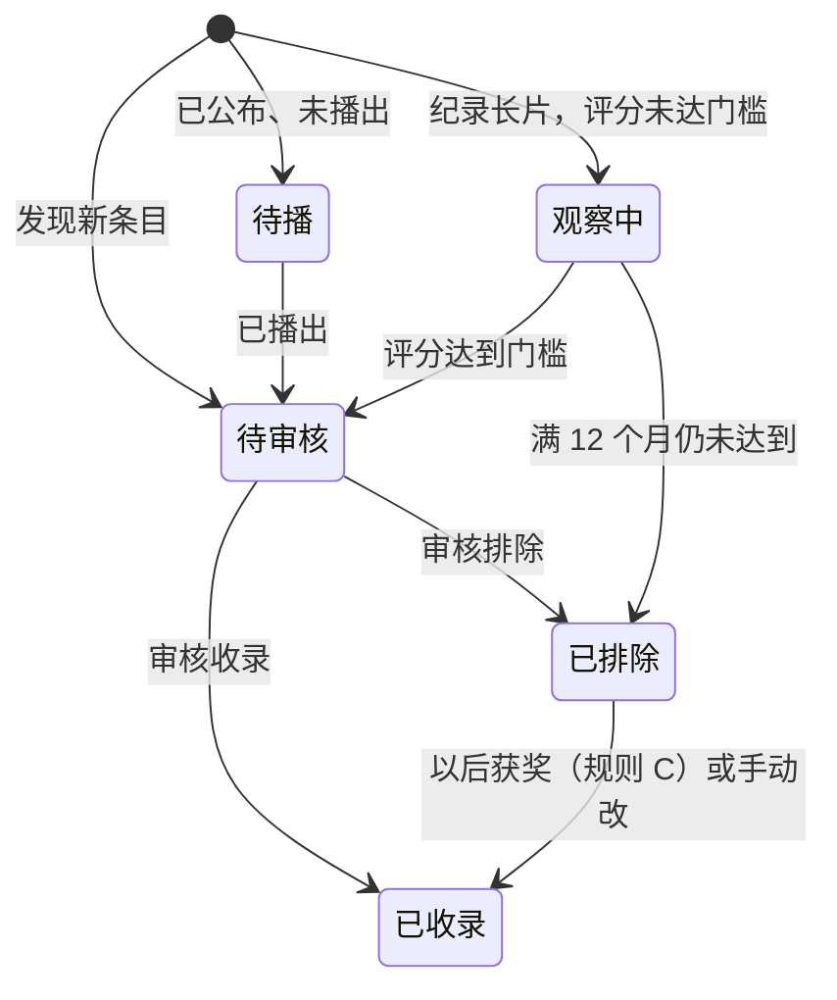

### 2.2 片源状态（NAS 上有没有，只对已收录的作品）

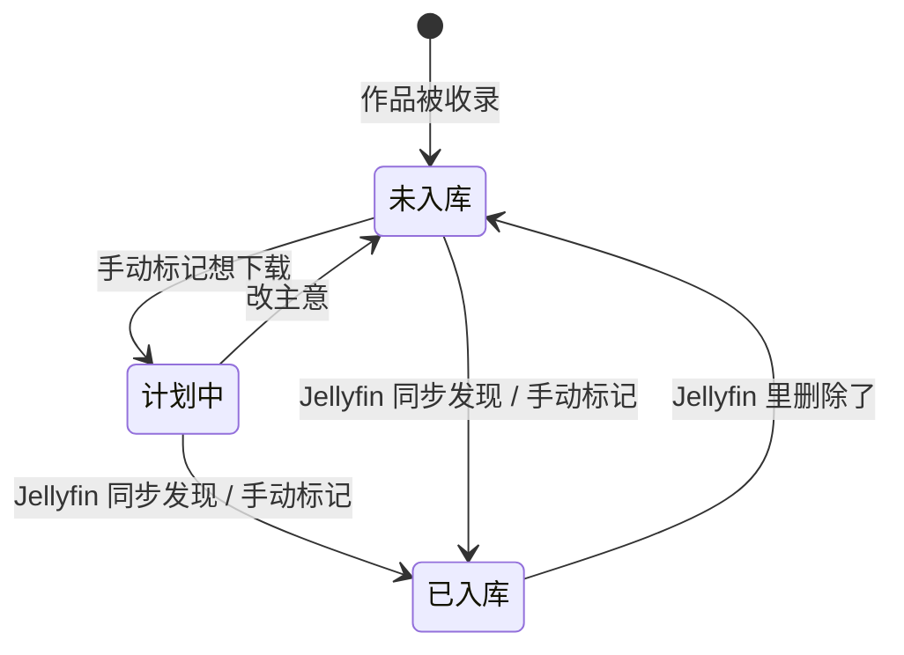

系列按季、长青栏目按集分别有片源状态，系列整体显示为“3/5 季已入库”。

---

## 3. 场景详情

### S0 更新纪录片数据（所有场景的起点）

数据要先从各来源拿回来，其他场景才有东西可看。有三种触发方式，走的是同一套流程：

| 触发方式 | 怎么做 | 适合 |
|---|---|---|
| **定时** | 树莓派 cron 每周触发，程序判断距上次成功满 14 天才真正运行 | 日常，不用管 |
| **命令行** | 电脑上直接运行命令；树莓派上 SSH 进去运行 `./doc <命令>` | 测试、排查问题、只更新某个来源 |
| **网页按钮** | 首页或运行记录页点“立即更新”，选任务和来源 | 手机上随手触发，不用 SSH |

手动触发（命令行和按钮）**不检查 14 天间隔**，点了就跑。手动跑成功后，各来源的检查时间照常更新，下一次定时任务从这里接着往后查，不会重复。

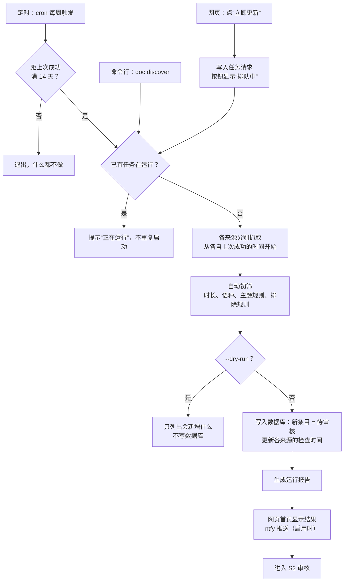

**常用的手动命令**（命令名为示意，实现时可能微调）：

| 想做什么 | 命令 |
|---|---|
| 更新全部来源 | `doc discover` |
| 只更新某个来源 | `doc discover --source tmdb` |
| 只更新某个品牌或频道 | `doc discover --brand bbc-earth` |
| 先看看会新增什么，不写数据库 | `doc discover --dry-run` |
| 手动刷新评分（平时每月自动） | `doc refresh` |
| 手动同步 Jellyfin 片源状态（平时每天自动） | `doc sync-jellyfin` |

### S1 周末挑片下载（最常用）

1. 打开**待下载**页，默认看到 `已收录` 且 `未入库` 的作品，按评分从高到低。
2. 按主题筛“历史”，再按年份筛 2020 年以后。
3. 看中几部，点“计划中”。系列可以只把其中几季标成计划中。
4. 切到“只看计划中”，得到这次的下载清单，去 qBittorrent 下载。
5. 下载完、Jellyfin 刮削后，第二天的同步任务把它们自动改成 `已入库`；系列显示“3/5 季已入库”。

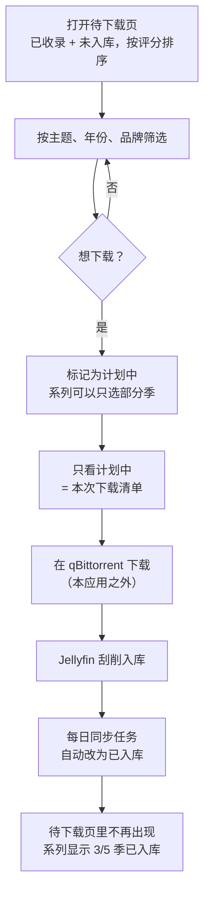

### S2 双周审核新内容

1. 打开网页首页，看到“双周发现完成，新增待审核 23 条，豆瓣失败”的提示（启用 ntfy 后，手机会直接收到这条推送；目前暂不启用）。
2. 点提示打开**运行记录**里的这次报告，看新增了什么、哪里失败。
3. 进**审核**页，按来源分组。像 Veritasium 这种单一主题频道，整组批量收录；National Geographic 这种综合频道逐条看初筛建议（主题、排除理由），点收录或排除。
4. 被排除的条目记下来，下次不再出现。

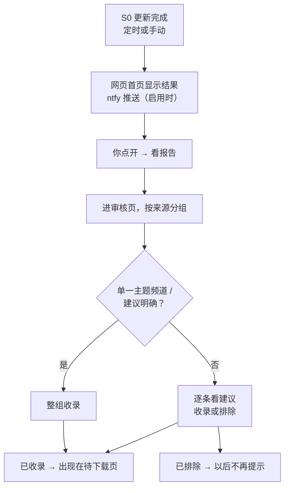

### S3 首次回溯的大批量审核

1. 回溯结束后待审核有数千条（YouTube 可能上万）。
2. 可选：先导出给大模型标定，再导入，让每条带上主题和排除建议。
3. 审核页按品牌/频道批量处理：先把建议“收录”且置信度高的整组确认，再逐条看有疑问的。
4. 审核页显示进度（剩余多少条、各品牌完成情况），可以分多次做完。

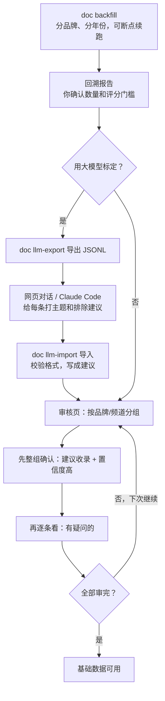

### S4 想看某类题材 / 查一部片

1. 在**作品列表**按品牌、主题、类型（系列 / 长片 / YouTube）、评分筛选。
2. 或者在顶部**搜索**框输入中文或英文标题，例如“地球脉动”或 “Planet Earth”。
3. 打开**详情**页，看简介、各来源评分（带“截至某年某月”）、有几季、哪几季已入库、YouTube 原始链接。

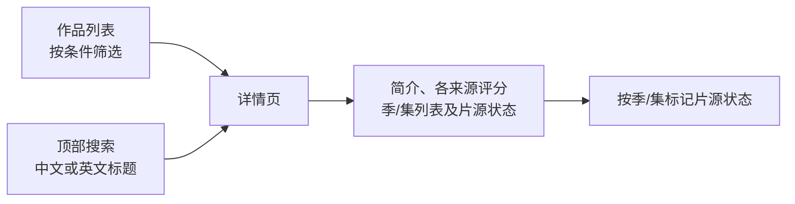

### S5 跟进新季和长青栏目

1. 系列出了新一季、*NOVA* 出了新一期，双周任务发现。**已收录系列的新一季自动收录**（品牌和主题已经定了），不进审核，只在报告里列出。
2. **最近新出品**页按双周周期列出新收录的内容，一眼看到“《某系列》第 3 季”，片源状态是 `未入库`。

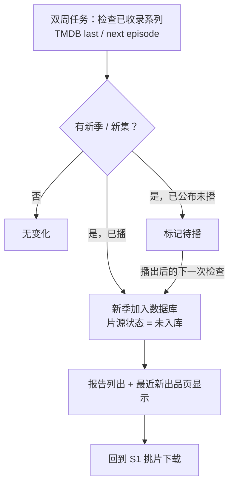

### S6 纪录长片评分观察

1. 新上映的纪录长片先进 `观察中`，每月刷新评分。
2. 达到门槛后转 `待审核`，出现在月度报告的“状态变化”里和审核页中。
3. 满 12 个月没达到，自动转 `已排除`，报告里列出。

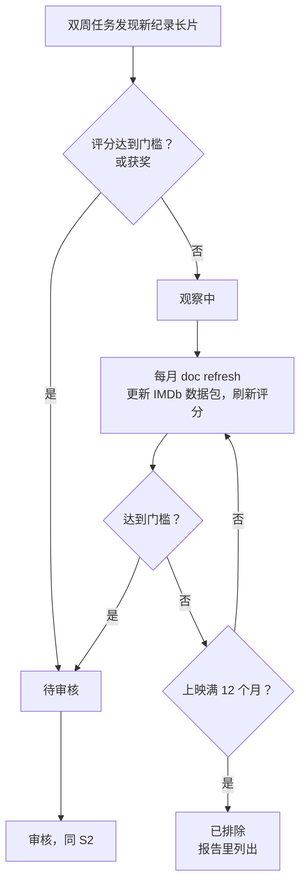

### S7 来源失败与人工补录

1. 豆瓣被拦截或栏目页改版，报告里“需要人工处理”列出受影响的条目；同一来源连续失败 3 次，网页首页醒目提示（启用 ntfy 时再单独告警）。
2. 在**人工补录**页手动填豆瓣评分和评价人数（或导入一个整理好的文件）。

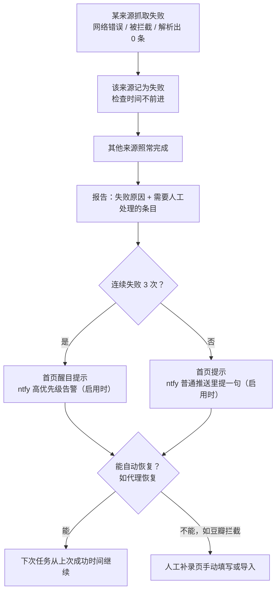

### S8 Jellyfin 匹配不上

1. 中文纪录片、YouTube 视频在 Jellyfin 里常常没有 TMDB / IMDb 编号，按标题也可能匹配不上。
2. **Jellyfin 未匹配**页列出这些 Jellyfin 条目，给出候选作品，手动点选对应关系；对应关系记住，以后同步自动用。

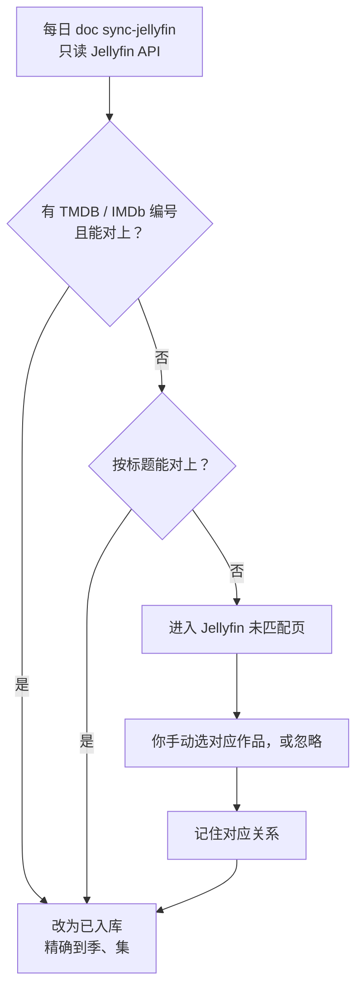

---

## 4. 页面清单

| 页面 | 主要内容 | 主要操作 | 场景 | 迭代 |
|---|---|---|---|---|
| 首页 / 概览 | 待审核数、计划中数、最近一次各任务的结果；有来源失败时醒目提示 | 跳到各页面；**立即更新**按钮 | S0、S2、S7 | 1（统计），3（任务结果、失败提示、立即更新） |
| 作品列表 | 全部 `已收录` 作品 | 按品牌、主题、年份、类型、评分、片源状态筛选和排序；一键切换片源状态 | S4 | 1 |
| 待下载 | `已收录` 且 `未入库` / `计划中` 的作品，默认按评分排序 | 同上筛选；“只看计划中”；标记计划中 | S1 | 1 |
| 详情 | 作品信息、各来源评分和拉取日期、季/集列表及每季/每集片源状态、YouTube 链接、跟踪状态历史 | 按季/集标记片源状态；改跟踪状态 | S1、S4 | 1；2 加各来源评分 |
| 搜索 | 顶部搜索框，中英文标题 | — | S4 | 1 |
| 审核 | 待审核条目，按来源/品牌/频道分组，附初筛建议和理由 | 逐条或整组收录/排除 | S2、S3、S5、S6 | 1；**6** 加大模型建议、按置信度筛选、进度 |
| Jellyfin 未匹配 | 同步时对不上的 Jellyfin 条目和候选作品 | 手动对应、忽略 | S8 | 4 |
| 最近新出品 | 按双周周期分组的新收录内容，带片源状态 | 切换周期；标记片源状态 | S5 | 3 |
| 运行记录 | 每次任务的报告（`architecture.md` 第 6.1 节），失败的来源标红；正在运行的任务显示进度 | 查看历史报告；**立即更新**：选任务（发现 / 刷新评分 / 同步 Jellyfin）和来源，运行中按钮变灰并显示“正在运行”，跑完显示报告链接 | S0、S2、S7 | 2（回溯结果、失败清单），3（立即更新、进度） |
| 人工补录 | 需要人工补评分或补信息的条目 | 手动填写或上传文件导入 | S7 | 2 |

- 品牌、频道、规则在 `config/*.yaml` 里改，**不做设置页**。
- 所有页面在手机浏览器上也要能用（收到推送后在手机上看报告、做简单审核）。

---

## 5. 已确认

1. 场景和页面清单按本文执行。
2. **已收录系列的新一季自动收录**，只在报告和“最近新出品”里列出。
3. ntfy 推送暂不启用，提示先看网页首页（`architecture.md` 第 6.2 节）。
