# 会话规划

> 后面的工作分成多个 Claude Code 会话来做。本文说明：分成哪些会话、每个会话做什么、怎么开始、怎么结束交接、云端会话和你的电脑怎么分工。
> 迭代内容见 `plan.md`，每个迭代内部怎么走见 `process.md`。

---

## 1. 为什么要分会话

- **一个阶段或迭代开一个新会话**：每个会话只关注一件事，上下文干净，不容易混淆前面讨论过但已经改掉的方案。
- **交接全部靠仓库里的文档**：`CLAUDE.md`（当前进度）、`plan.md`（计划和状态）、`iterations/iter-N.md`（每个迭代的计划和验收结果）。新会话开头读这些就能接上，不依赖之前的聊天记录。
- **每个会话结束前必须提交并推送**：云端会话的运行环境用完会被回收，没推送到 GitHub 的改动会丢失。

---

## 2. 会话清单

```mermaid
flowchart LR
    A["会话 A<br/>阶段 1 收尾"] --> B["会话 B<br/>阶段 2 数据设计"]
    B --> C["会话 C<br/>迭代 0 骨架"]
    C --> D["会话 D<br/>迭代 1 TMDB 小范围"]
    D --> E1["会话 E1<br/>迭代 2a TMDB + IMDb"]
    E1 --> E2["会话 E2<br/>迭代 2b YouTube"]
    E2 --> E3["会话 E3<br/>迭代 2c 豆瓣 + 中文平台"]
    E3 --> F["会话 F<br/>迭代 3 定期更新"]
    F --> G["会话 G<br/>迭代 4 Jellyfin"]
    G --> H["会话 H<br/>迭代 5 树莓派"]
    H --> I["会话 I<br/>迭代 6 批量审核 v1.0"]
```

| 会话 | 内容 | 主要产出 | 需要你在会话里做的事 | 建议在哪里运行 |
|---|---|---|---|---|
| **A**（当前） | 阶段 1 收尾 | 阶段 1 文档确认；合并请求合并到 `main` | 回答待确认问题；在 GitHub 上点合并 | 云端 |
| **B** | 阶段 2 数据设计 | `data-model.md`、`source-mapping.md`、配置文件格式、试点 2–3 个品牌的 ID | 确认数据模型；核对试点品牌 ID | 云端 |
| **C** | 迭代 0 工程骨架 | v0.0：能安装、能运行的空项目 | 在 Windows 上按 README 安装，验收 | 云端写代码，你在电脑上验收 |
| **D** | 迭代 1 TMDB 小范围 | v0.1：最小闭环 | 提供 TMDB API key；验收；试用几天 | 云端或 Windows（见第 4 节） |
| **E1** | 迭代 2a TMDB + IMDb | 全部品牌和纪录长片的数据；覆盖报告第一部分 | 核对品牌 ID；确认名作核对清单；看报告 | **Windows 上的 Claude Code**（推荐） |
| **E2** | 迭代 2b YouTube | 全部频道的数据；覆盖报告第二部分 | 提供 YouTube API key；核对频道 ID；看报告 | **Windows 上的 Claude Code**（推荐） |
| **E3** | 迭代 2c 豆瓣 + 中文平台 | 中文数据、人工补录页；覆盖报告完成 | 看报告；决定门槛要不要调 | **Windows 上的 Claude Code**（推荐） |
| **F** | 迭代 3 定期更新 + 报告 + 推送 | v0.3 | 手机装 ntfy；验收 | 云端或 Windows |
| **G** | 迭代 4 Jellyfin 同步 | v0.4 | 提供 Jellyfin API key；验收 | **Windows 上的 Claude Code**（推荐） |
| **H** | 迭代 5 部署到树莓派 | v0.5，开始日常使用 | 提供树莓派 SSH 访问 | **Windows 上的 Claude Code**（推荐） |
| **I** | 迭代 6 批量审核 + 大模型标定 | v1.0 | 首轮审核 | 云端或 Windows |
| 之后 | 阶段 4 试运行，按需开 | 试运行报告、`scope.md` v2 | 反馈使用感受 | 按需 |

- 一个迭代如果验收时问题较多，可以在同一个会话里继续修。
- 会话很长时，在一个稳定的节点提交推送，开新会话接着做（开场白里说明“继续迭代 N”）。
- 迭代 2 的三步各开一个会话：每步数据量大、要你核对的东西多，分开更清楚。

---

## 3. 每个会话的固定流程

**开始时**
1. 读 `CLAUDE.md` 和 `plan.md`，以及这一步相关的文档。
2. 先向你说明：这一步做什么、交付什么、需要你提供或决定什么。
3. 迭代会话：写迭代计划 `docs/iterations/iter-N.md`（目标、包含和不包含的功能、验收清单），**等你确认后再开始写代码**。

**结束时**
1. 更新 `plan.md` 的状态、`CLAUDE.md` 的“当前进度”、迭代文档里的验收结果。
2. 提交、推送。
3. 开合并请求，你在 GitHub 上点“合并”。
4. 告诉你下一个会话的开场白。

---

## 4. 云端会话和你电脑的分工

这一点要提前想清楚：

- **云端会话**（你现在用的这种）：运行在 Anthropic 的云端环境里。能写代码、跑自动化测试（用存好的接口样例）、推送到 GitHub。**连不到你的 Windows 电脑、家里的 Jellyfin 和树莓派**，也没有你的 API key 和代理。
- **但真实运行需要你的环境**：真实数据的全量回溯（迭代 2）要用你的 API key 和代理，数据库在你电脑上；Jellyfin 同步（迭代 4）要连家里的 Jellyfin；部署（迭代 5）要连树莓派。

两种做法：

| 做法 | 怎么做 | 优点 | 缺点 |
|---|---|---|---|
| (a) 云端写代码，你来运行 | 我写好代码、命令和验收清单；你在电脑上执行，把输出或报告发给我 | 不用在电脑上装 Claude Code | 来回传结果慢；出错时要你帮忙看日志 |
| **(b) 在 Windows 上用 Claude Code**（推荐，从迭代 2 起） | 在电脑上装 Claude Code（桌面版或命令行），会话直接在你的电脑上运行命令、读报告 | 我可以直接跑回溯、看失败、修问题；通过 Tailscale 也能连 Jellyfin 和树莓派 | 需要在电脑上装一次 Claude Code |

- 阶段 2、迭代 0 主要是写文档和写代码，云端就够了。
- 迭代 1 可以先试试做法 (a)，体验一下来回的过程，再决定迭代 2 起要不要换成 (b)。
- 不管用哪种，代码都在 GitHub 上，两种方式可以随时切换。
- **API key 不要发在对话里**：放在你电脑上的 `.env` 文件里（`architecture.md` 第 7 节）。用做法 (b) 时，程序直接从你电脑上的 `.env` 读取。

---

## 5. 开场白模板

开新会话时，直接复制对应的一段发给 Claude：

| 会话 | 开场白 |
|---|---|
| B | 继续纪录片项目，开始阶段 2 数据设计。先读 CLAUDE.md 和 docs/plan.md，告诉我这个阶段要做什么、交付什么、需要我准备什么。 |
| C | 继续纪录片项目，开始迭代 0 工程骨架。先读 CLAUDE.md、docs/plan.md、docs/process.md，写出迭代计划给我确认。 |
| D | 继续纪录片项目，开始迭代 1 TMDB 小范围最小闭环。先读 CLAUDE.md、docs/plan.md、docs/data-model.md，写出迭代计划给我确认。 |
| E1 | 继续纪录片项目，开始迭代 2a：TMDB 全部品牌 + 纪录长片 + IMDb 评分。先读 CLAUDE.md、docs/plan.md、docs/scope.md，写出迭代计划给我确认。 |
| E2 | 继续纪录片项目，开始迭代 2b：YouTube 全部频道。先读 CLAUDE.md、docs/plan.md、docs/iterations/iter-2a.md，写出迭代计划给我确认。 |
| E3 | 继续纪录片项目，开始迭代 2c：豆瓣 + 中文平台 + 人工补录。先读 CLAUDE.md、docs/plan.md、docs/iterations/iter-2b.md，写出迭代计划给我确认。 |
| F | 继续纪录片项目，开始迭代 3：定期更新 + 报告 + 推送。先读 CLAUDE.md、docs/plan.md，写出迭代计划给我确认。 |
| G | 继续纪录片项目，开始迭代 4：Jellyfin 同步。先读 CLAUDE.md、docs/plan.md，写出迭代计划给我确认。 |
| H | 继续纪录片项目，开始迭代 5：部署到树莓派。先读 CLAUDE.md、docs/plan.md、docs/architecture.md 第 9 节，写出迭代计划给我确认。 |
| I | 继续纪录片项目，开始迭代 6：批量审核 + 大模型标定。先读 CLAUDE.md、docs/plan.md，写出迭代计划给我确认。 |
| 续接 | 继续纪录片项目的迭代 N，上个会话做到了 ___。先读 CLAUDE.md 和 docs/iterations/iter-N.md，告诉我现在的状态。 |

---

## 6. 提前准备的东西

| 什么 | 怎么做 | 什么时候需要 |
|---|---|---|
| TMDB API key | 在 themoviedb.org 注册账号 → 账号设置 → API → 申请（个人非商业用途），拿到 API key。会话 D 开始时我再一步步带你核对 | 会话 D（迭代 1） |
| 名作核对清单 | 列 20–30 部你熟悉、确定应该收录的纪录片（英文、中文、系列、长片、YouTube 都要有），会话 E1 里我再补到约 50 部 | 会话 E1（迭代 2a） |
| 决定会话运行方式 | 第 4 节的 (a) 或 (b) | 会话 E1 之前 |
| YouTube Data API key | 会话 E2 开始时我带你在 Google Cloud 上申请 | 会话 E2（迭代 2b） |
| 手机装 ntfy | 应用商店搜 ntfy | 会话 F（迭代 3） |
| Jellyfin API key | Jellyfin 后台 → 控制台 → API 密钥 → 新建 | 会话 G（迭代 4） |
| 树莓派 SSH 访问 | 会话 H 里说明 | 会话 H（迭代 5） |
