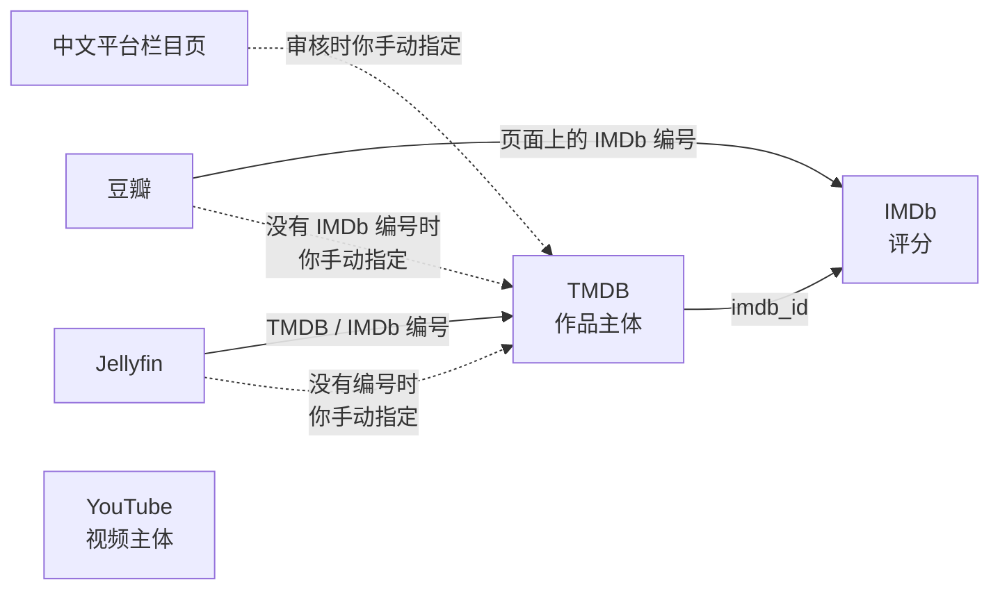

# 来源字段映射

> 阶段 2 的交付物之一。说明每个来源拿什么数据、怎么对应到 `data-model.md` 里的表和字段、各来源之间怎么对上同一部作品。
> 接口细节（参数名、分页方式）在实现时以官方文档为准；这里定的是“拿什么、放哪里、怎么对上”。

---

## 1. 总览

| 来源 | 拿什么 | 建立什么 | 主要编号 | 什么时候做 |
|---|---|---|---|---|
| TMDB | 系列、季、集、长片的元数据；中英文标题和简介；关键词；TMDB 评分 | 作品、季、集的主体 | TMDB 剧集编号 / 电影编号 | 迭代 1、2a |
| IMDb 数据包 | 评分、评分人数、副类型、单集编号 | 评分记录；补充 IMDb 编号 | `tt` 编号 | 迭代 2a |
| YouTube | 频道上传的视频、时长、播放量、分类 | `kind = video` 的作品 | 视频编号 | 迭代 2b |
| 豆瓣 | 中文片、中文系列（按季）的评分和人数；中文标题 | 评分记录；TMDB 上没有的中文作品 | 豆瓣条目编号 | 迭代 2c |
| 中文平台栏目页 | 新出现的纪录片条目（标题、链接、日期） | 待审核作品（再去 TMDB / 豆瓣对上） | 栏目页链接 | 迭代 2c |
| Jellyfin | 媒体库里的作品、季、集及其自带编号 | 片源状态 | Jellyfin 条目编号 | 迭代 4 |

**谁是作品的“主体来源”**：系列和长片以 TMDB 为主体（标题、季集结构以 TMDB 为准）；YouTube 视频以 YouTube 为主体；TMDB 上没有的中文作品以豆瓣为主体。其他来源只往上补编号和评分。

---

## 2. TMDB

### 2.1 怎么发现

| 方式 | 用法 | 对应 |
|---|---|---|
| 按品牌 | `discover/tv`、`discover/movie`：纪录片类型（编号 99）+ 品牌的播出方或出品公司编号 + 日期范围 | `brand.tmdb_networks` / `tmdb_companies` |
| 重点栏目 | 直接按 `series_watch.tmdb_tv_id` 取详情，不经过类型筛选 | `series_watch` |
| 手动收录 | 直接按 `config/includes.yaml` 里的编号取详情 | `manual_include` |
| 新季、新集 | 已收录系列重新取详情，看季列表、最近一集、下一集 | 季、集；`upcoming_date` |

### 2.2 字段对应：系列（`tv/{id}`）

| TMDB 字段 | 放到 | 说明 |
|---|---|---|
| `id` | `external_ref`（tmdb，挂作品） | |
| `name`（英文请求） | `title.title_en` | |
| `name`（中文请求） | `title.title_zh` | 中文请求时有中文译名才用；没有就留空，等豆瓣补 |
| `original_name` / `original_language` | `title_original` / `original_language` | 语种判断用（`scope.md` 第 1 节） |
| `first_air_date` | `release_date`、`year` | |
| `overview`（英文 / 中文请求） | `overview_en` / `overview_zh` | |
| `networks`、`production_companies` | 判断品牌；出品方写进 `producers` | |
| `genres` | 初筛参考 | 只有“纪录片”一类，太粗（`scope.md` 第 6.1 节） |
| 关键词（`keywords`） | 主题规则的输入 | |
| `seasons[]`（季号、集数、首播日期） | `season` | 第 0 季（特辑）单独处理，默认不收 |
| `last_episode_to_air` / `next_episode_to_air` | 新集发现；`upcoming_date` | |
| `external_ids.imdb_id` | `external_ref`（imdb，挂作品） | 和 IMDb 数据包对上的关键 |
| `vote_average` / `vote_count` | `rating`（tmdb） | 只作补充，不作为收录依据 |
| `poster_path` | `poster_path` | |

### 2.3 字段对应：季和集（`tv/{id}/season/{n}`）

| TMDB 字段 | 放到 |
|---|---|
| `episodes[].episode_number` / `name` / `air_date` / `runtime` / `overview` | `episode` |
| `episodes[].id` | `external_ref`（tmdb，挂集） |

- 长青栏目只取 `since_year`（默认 2010）以后的季和集。
- 单集的 IMDb 编号不逐集去 TMDB 查（请求太多），用 IMDb 数据包的 `title.episode` 按“系列编号 + 季号 + 集号”对上（第 3 节）。

### 2.4 字段对应：长片（`movie/{id}`）

| TMDB 字段 | 放到 |
|---|---|
| `title`（英文 / 中文请求）、`original_title` | `title_en` / `title_zh` / `title_original` |
| `release_date`、`runtime` | `release_date`、`runtime_min` |
| `imdb_id` | `external_ref`（imdb） |
| `production_companies` | 判断品牌；`producers` |
| `overview`、`poster_path`、`vote_average` / `vote_count` | 同系列 |

---

## 3. IMDb 公开数据包

只用三个文件，逐行流式读，只留纪录片相关的行（`architecture.md` 第 3.1 节）：

| 文件 | 字段 | 用途 |
|---|---|---|
| `title.basics` | `tconst`、`titleType`、`primaryTitle`、`startYear`、`runtimeMinutes`、`genres` | 筛出 `genres` 含 Documentary 的条目；`titleType` 区分长片（`movie`）、系列（`tvSeries` / `tvMiniSeries`）、单集（`tvEpisode`） |
| `title.ratings` | `tconst`、`averageRating`、`numVotes` | `rating`（imdb） |
| `title.episode` | `tconst`、`parentTconst`、`seasonNumber`、`episodeNumber` | 给单集补 IMDb 编号 |

**副类型的用途**（`scope.md` 第 6.1 节）：`History`、`War` → 主题“历史”；`Crime`、`Sport`、`Music`、`News`、`Biography` → 标出疑似要排除的。

**评分挂在哪**：长片 → 作品；系列整体评分 → 作品；单集评分 → 集。IMDb 没有按季的评分。

**对上方式**：只通过 TMDB 给出的 `imdb_id` 对上，不按标题猜。TMDB 没有给 IMDb 编号的作品，就没有 IMDb 评分，在覆盖报告里列出。

---

## 4. YouTube Data API

| 接口 | 拿什么 | 放到 |
|---|---|---|
| `channels.list` | 频道的上传列表编号 | `channel.uploads_playlist_id`（一次性） |
| `playlistItems.list` | 上传列表里的视频编号、发布时间（往前翻页到上次检查的时间） | 待取详情的视频清单 |
| `videos.list`（每 50 条一批） | 见下表 | `title`（`kind = video`）+ `youtube_video` |

| `videos.list` 字段 | 放到 | 说明 |
|---|---|---|
| `id` | `youtube_video.video_id`；`external_ref`（youtube） | |
| `snippet.title` | `title_en` 或 `title_zh` | 按文字判断是英文还是中文 |
| `snippet.description` | `overview_en` / `overview_zh` | 主题关键词规则的输入 |
| `snippet.publishedAt` | `published_at`、`release_date` | |
| `snippet.categoryId` | `youtube_category` | “新闻与政治”标出疑似时政 |
| `snippet.defaultAudioLanguage` | `original_language` | 不一定有 |
| `contentDetails.duration` | `duration_sec`、`runtime_min` | 时长门槛（`channel.min_duration_min`）；也用来过滤 Shorts |
| `statistics.viewCount` / `likeCount` | `view_count` / `like_count` | YouTube 没有评分 |
| `snippet.liveBroadcastContent` | 初筛 | 直播和直播预告不收 |

---

## 5. 豆瓣（半自动）

| 页面上的信息 | 放到 | 说明 |
|---|---|---|
| 条目编号（链接里的数字） | `external_ref`（douban）：长片挂作品，**系列按季挂季** | 豆瓣每一季是独立条目 |
| 中文标题 | `title_zh`（TMDB 没给中文名时） | |
| 评分、评价人数 | `rating`（douban） | 规则 B 的依据 |
| 页面上列出的 IMDb 编号 | 对上作品的首选方式 | 很多条目页面上有 IMDb 编号 |
| 年份、类型、制片国家、集数 | 对上时核对用 | |

**怎么对上**：
1. 页面有 IMDb 编号 → 按 IMDb 编号对上已有作品。
2. 没有 IMDb 编号 → **不自动对上**，进人工处理（`manual_task`），由你指定对应哪部作品，或确认是新作品。
3. 系列的某一季：先按 IMDb 编号对上系列，再按季号对上季（豆瓣标题里通常带“第二季”）。
4. 你确认是 TMDB 上没有的中文作品：以豆瓣为主体新建作品，进待审核。

**抓不到时**：被拦截、页面改版、搜索没结果都记进 `manual_task`，在人工补录页手动填评分和人数（`origin = 人工补录`）。

---

## 6. 中文平台栏目页（半自动）

| 栏目页信息 | 用途 |
|---|---|
| 标题、详情页链接、上线日期 | 发现新作品：以栏目页信息新建、进待审核。栏目页没有 TMDB / IMDb 编号，所以不自动和已有作品合并；审核时如果发现是已有作品，你可以指定对应关系 |
| 详情页链接 | 写进 `watch_link`（观看渠道） |

- 每个站点一个解析器，先做央视网纪录频道。
- 解析出 0 条视为失败（页面可能改版），记进 `manual_task`，而不是当成“没有新内容”。

---

## 7. Jellyfin（只读，迭代 4）

| Jellyfin 字段 | 用途 |
|---|---|
| 条目编号、名称、类型（系列 / 季 / 集 / 电影） | `jellyfin_item` |
| `ProviderIds` 里的 TMDB、IMDb 编号 | 首选的对上方式 |
| 季号、集号（集的父级序号、序号） | 定位到 `season` / `episode` |

**对上顺序**（只按编号）：
1. TMDB 编号；
2. IMDb 编号；
3. 编号在本应用里找不到 → 说明这部片不在收录范围（比如普通电影），**忽略**，不提示；
4. 条目没有任何编号 → 放进 Jellyfin 未匹配页，你手动对应或忽略，并记住。你的 Jellyfin 库都已刮削出编号，所以这一步预计很少用到。

对上后，把对应的作品（长片、视频）、季（普通系列）或集（长青栏目）的片源状态改成 `已入库`（`data-model.md` 第 3.2 节）。

---

## 8. 同一部作品在不同来源之间怎么对上

**当前决定：只按编号自动对上，不按标题自动对上。**

- 实线：按编号对上，可靠，自动进行。
- 虚线：没有编号时，由你手动指定，程序记住，以后不再问。
- 理由：按标题容易对错，对错了评分和片源状态会安到别的片上，而且不容易发现。你的 Jellyfin 库都有编号，豆瓣页面大多也有 IMDb 编号，需要手动指定的应该是少数。
- 按标题自动对上（只在候选唯一时）放进 `plan.md` 待办清单：如果以后手动指定的量太大，再加。

**例子**

| 情况 | 例子 | 结果 |
|---|---|---|
| 按编号对上 | 豆瓣《地球脉动 第三季》页面上写着它的 IMDb 编号；TMDB 的 *Planet Earth III* 也有同一个 IMDb 编号 | 确定是同一部，自动对上 |
| Jellyfin 条目有编号 | Jellyfin 里的 *Horizon* 刮削时写入了 TMDB 编号 1966 | 自动对上 BBC 的 *Horizon*（同名的还有 PBS 新闻节目 3583、CBC 的 33365，按编号不会混） |
| Jellyfin 条目的编号不在本应用里 | 你库里的一部普通电影 | 忽略，不提示 |
| 没有编号 | 豆瓣某个中文纪录片页面上没写 IMDb 编号 | 进人工处理，你指定对应哪部作品，或确认是新作品 |

- YouTube 视频自成一类，不和 TMDB 作品合并（`scope.md` 第 7.3 节）；电视台重新上传的某一集，以后可以作为观看渠道挂到对应作品下。
